# Access: class diagrams

These diagrams show which parts of the Access module call which, and the method each call goes through.

This is the reference for the Access module. Keep it in step with the code: when a component, a call between components, or a transaction boundary changes, update the matching diagram and table in the same commit.

- [Component interactions](#component-interactions) is the main reference: one diagram with every component, what each component contains, and the calls each operation makes, in order.
- [Transaction scopes](#transaction-scopes) shows where each transaction starts and ends, and what runs inside it.
- [Class-level detail](#class-level-detail) zooms in to individual classes, one flow at a time.
- [What is not reusable across contexts](#what-is-not-reusable-across-contexts) lists what to copy, not share, when another context needs an outbox.

All paths are under `backend/src/main/java/me/dhiren9939/backend/`.

How to read the arrows:

| Arrow | Meaning |
|---|---|
| `A --> B : m()` | A calls `m()` on B |
| `A ..\|> B` | A implements B |
| `A ..> B : creates / throws` | A creates, returns or throws B |

## Component interactions

Each box is a component. The text in `<<...>>` is its layer, and the members are the operations other components call. Colours: presentation is blue, application is green, domain is yellow, common (the published contract) is purple, infrastructure is grey, and external systems are white.

```mermaid
classDiagram
    direction TB

    class HttpClient["HTTP client"] {
        <<external>>
    }
    class OtherModules["Other modules"] {
        <<external>>
    }

    class Controller["ApiKeyController + DTOs"] {
        <<presentation>>
        +POST /api/v1/user/userId/apikey
        +GET /apikey/apiKeyId
        +PATCH /apikey/apiKeyId
        +DELETE /apikey/apiKeyId
    }
    class ErrorHandlers["Error handlers"] {
        <<presentation>>
        ApiKeyExceptionHandler
        WebExceptionHandler
        +ApiProblems.of(status, code, detail)$ ProblemDetail
    }
    class Facade["ApiKeyFacadeImpl"] {
        <<presentation>>
        +verifyApiKey(VerifyApiKeyQuery) ApiKeyVerifyResult
    }

    class VerificationContract["Verification contract"] {
        <<common>>
        +ApiKeyVerificationFacade.verifyApiKey(VerifyApiKeyQuery) ApiKeyVerifyResult
        ApiKeyVerifyResult = Success or Failure
        VerificationFailureCode
    }
    class IntegrationEvents["Integration events"] {
        <<common>>
        ApiKeyCreatedIntegrationEvent
        ApiKeyUpdatedIntegrationEvent
        ApiKeyDeletedIntegrationEvent
    }

    class OwnerUseCases["Owner use cases"] {
        <<application>>
        +IssueApiKeyUseCase.handle(IssueApiKeyCommand) IssuedApiKeyResult
        +GetApiKeyUseCase.handle(GetApiKeyQuery) ApiKeyView
        +UpdateApiKeyUseCase.handle(UpdateApiKeyCommand) ApiKeyView
        +DeleteApiKeyUseCase.handle(DeleteApiKeyCommand) void
    }
    class VerifyUseCase["Verify use case"] {
        <<application>>
        +VerifyApiKeyUseCase.handle(VerifyApiKeyQuery) VerifiedApiKey
        throws ApiKeyVerificationFailure
    }
    class RetriedTransaction {
        <<application>>
        +execute(Supplier~T~) T
        +execute(Runnable) void
    }
    class ApiKeyView {
        <<application>>
        +of(ApiKey, now)$ ApiKeyView
    }
    class EventMapper["Event mapper"] {
        <<application>>
        +toIntegrationEvent(ApiKeyEvent) ApiKeyIntegrationEvent
    }
    class Ports {
        <<application>>
        +IssueCredentialPort.issue() IssuedCredential
        +CredentialVerifier.supports(keyFormat) boolean
        +CredentialVerifier.isWellFormed(accessId, secret) boolean
        +CredentialVerifier.matches(secret, storedHash) boolean
    }

    class Aggregate["ApiKey aggregate"] {
        <<domain>>
        +issue(userId, name, credential, permissions, lifetime, createdAt)$ ApiKey
        +update(ApiKeyChanges, now) boolean
        +delete(now) void
        +pullDomainEvents() List~ApiKeyEvent~
        +getPermissions() Permissions
        +isOwnedBy(userId) boolean
        +state(now) ApiKeyState
        +canAuthenticate(now) boolean
    }
    class ValueTypes["Value types"] {
        <<domain>>
        +Permissions.of(map) / with(scope, level) / levelOf(scope) / asMap()
        +PermissionChanges.applyTo(Permissions) Permissions
        +Scope.requireAllowed(AccessLevel) void
        +Lifetime.expiryFrom(now) Instant
    }
    class DomainEvents["Domain events"] {
        <<domain>>
        ApiKeyCreated
        ApiKeyUpdated
        ApiKeyDeleted
    }
    class ApiKeys {
        <<domain>>
        +findById(apiKeyId) Optional~ApiKey~
        +findByAccessId(accessId) Optional~ApiKey~
        +save(ApiKey) ApiKey
        +delete(ApiKey) void
        +requireOwned(userId, apiKeyId) ApiKey
    }
    class DomainExceptions["Domain exceptions"] {
        <<domain>>
        ApiKeyNotFoundException
        ApiKeyUpdateFailure
        InvalidApiKeyException + ApiKeyViolation
        InvalidPermissionsException
    }

    class ApiKeysAdapter["ApiKeysAdapter + JpaApiKeyRepository"] {
        <<infrastructure>>
    }
    class Outbox["Outbox"] {
        <<infrastructure>>
        +EventOutboxEntity.of(eventId, event, payload)$ EventOutboxEntity
        +EventOutboxRepository.save(row)
        +EventOutboxRepository.lockPending(limit)
    }
    class Serializer["IntegrationEventSerializer"] {
        <<infrastructure>>
        +toJson(eventId, event) String
        +withEmittedAt(payload, at) String
    }
    class Deserializer["JsonApiKeyIntegrationEventDeserializer"] {
        <<infrastructure>>
        +deserialize(body) ApiKeyIntegrationEvent
    }
    class OutboxStore {
        <<infrastructure>>
        +append(event) void
        +lockPending(limit) List
        +markEmitted(row, at, body) void
        +recordFailure(row, error) void
    }
    class OutboxRelay["OutboxRelay + OutboxRelayHealth"] {
        <<infrastructure>>
        +tick() void every 2s
        +halt() Optional~Halt~
    }
    class ProjectionStream["ProjectionStream + RabbitProjectionStream"] {
        <<infrastructure>>
        +declare() void
        +send(row, body) CompletableFuture~Boolean~
    }
    class KeyFormats["Key formats"] {
        <<infrastructure>>
        +CredentialIssuer.keyFormat() / issue()
        V1CredentialIssuer
        V1CredentialVerifier
    }
    class Config {
        <<infrastructure>>
        +ApiKeyConfig.issueCredentialPort(issuers, format)
        +OutboxRelayConfig beans
    }

    class Postgres["Postgres access schema"] {
        <<external>>
    }
    class RabbitMQ["RabbitMQ apikey.projections"] {
        <<external>>
    }

    %% entry points
    HttpClient --> Controller : POST / GET / PATCH / DELETE
    OtherModules --> VerificationContract : verifyApiKey(query)
    Facade ..|> VerificationContract

    %% presentation to application
    Controller --> OwnerUseCases : handle(command or query)
    Controller --> ValueTypes : Permissions.of() / new PermissionChanges() / levelOf()
    Facade --> VerifyUseCase : handle(query)
    Facade --> ValueTypes : asMap()
    ErrorHandlers --> DomainExceptions : code() / getMessage()
    ErrorHandlers --> VerifyUseCase : ApiKeyVerificationFailure.code()

    %% owner use cases
    OwnerUseCases --> Ports : issue()
    OwnerUseCases --> ValueTypes : Lifetime.expiryFrom(createdAt)
    OwnerUseCases --> Aggregate : ApiKey.issue() / update(changes, now) / delete(now)
    OwnerUseCases --> ApiKeys : requireOwned() / save(key) / delete(key)
    OwnerUseCases --> RetriedTransaction : execute(work)
    OwnerUseCases --> ApiKeyView : of(key, now)
    RetriedTransaction ..> DomainExceptions : throws ApiKeyUpdateFailure
    ApiKeyView --> Aggregate : getters / state(now)

    %% verify use case
    VerifyUseCase --> Ports : supports(keyFormat) / isWellFormed(accessId, secret) / matches(secret, hash)
    VerifyUseCase --> ApiKeys : findByAccessId(accessId)
    VerifyUseCase --> Aggregate : getAccessSecretHash() / canAuthenticate(now)

    %% domain
    Aggregate --> ValueTypes : Permissions.of() / applyTo() / expiryFrom()
    Aggregate ..> DomainEvents : registers on issue / update / delete
    ValueTypes ..> DomainExceptions : throws InvalidPermissionsException
    Aggregate ..> DomainExceptions : throws InvalidApiKeyException
    ApiKeys --> Aggregate : isOwnedBy(userId)
    ApiKeys ..> DomainExceptions : throws ApiKeyNotFoundException

    %% write path into the outbox
    ApiKeysAdapter ..|> ApiKeys
    ApiKeysAdapter --> Postgres : JPA save / delete / find
    ApiKeysAdapter --> Aggregate : pullDomainEvents()
    ApiKeysAdapter --> EventMapper : toIntegrationEvent(event)
    ApiKeysAdapter --> OutboxStore : append(integrationEvent)
    OutboxStore --> Serializer : toJson(eventId, event)
    OutboxStore --> Outbox : EventOutboxEntity.of() / save(row)
    EventMapper --> DomainEvents : getters
    EventMapper --> ValueTypes : asMap()
    EventMapper ..> IntegrationEvents : builder().build()
    Outbox --> Postgres : access.outbox

    %% key formats and wiring
    KeyFormats ..|> Ports
    Config --> KeyFormats : keyFormat()
    Config ..> Ports : creates IssueCredentialPort
    Config ..> OutboxRelay : creates relay / stream / health

    %% relay out of the outbox
    OutboxRelay --> OutboxStore : lockPending() / markEmitted() / recordFailure()
    OutboxRelay --> Serializer : withEmittedAt(payload, at)
    OutboxRelay --> ProjectionStream : declare() / send(row, body)
    OutboxStore --> Outbox : lockPending(limit) / setters
    ProjectionStream --> RabbitMQ : super stream, routed by apiKeyId

    %% transaction boundaries
    note for OwnerUseCases "TX starts here\nIssue: @Transactional\nGet: @Transactional(readOnly)\nUpdate, Delete: via RetriedTransaction"
    note for RetriedTransaction "TX starts here\nREQUIRES_NEW per attempt\nretried on optimistic-lock conflict"
    note for VerifyUseCase "TX starts here\n@Transactional(readOnly)"
    note for OutboxRelay "TX starts here\nTransactionTemplate per tick\nRabbitMQ is NOT in the TX"
    note for ApiKeysAdapter "no TX of its own\njoins the caller's TX"

    %% layer colours (per-node style works in Mermaid 10 and 11)
    style Controller fill:#dbeafe,stroke:#1d4ed8,color:#000
    style ErrorHandlers fill:#dbeafe,stroke:#1d4ed8,color:#000
    style Facade fill:#dbeafe,stroke:#1d4ed8,color:#000
    style OwnerUseCases fill:#dcfce7,stroke:#15803d,color:#000
    style VerifyUseCase fill:#dcfce7,stroke:#15803d,color:#000
    style RetriedTransaction fill:#dcfce7,stroke:#15803d,color:#000
    style ApiKeyView fill:#dcfce7,stroke:#15803d,color:#000
    style EventMapper fill:#dcfce7,stroke:#15803d,color:#000
    style Ports fill:#dcfce7,stroke:#15803d,color:#000
    style Aggregate fill:#fef9c3,stroke:#a16207,color:#000
    style ValueTypes fill:#fef9c3,stroke:#a16207,color:#000
    style DomainEvents fill:#fef9c3,stroke:#a16207,color:#000
    style ApiKeys fill:#fef9c3,stroke:#a16207,color:#000
    style DomainExceptions fill:#fef9c3,stroke:#a16207,color:#000
    style VerificationContract fill:#f3e8ff,stroke:#7e22ce,color:#000
    style IntegrationEvents fill:#f3e8ff,stroke:#7e22ce,color:#000
    style ApiKeysAdapter fill:#e5e7eb,stroke:#374151,color:#000
    style Outbox fill:#e5e7eb,stroke:#374151,color:#000
    style Serializer fill:#e5e7eb,stroke:#374151,color:#000
    style OutboxStore fill:#e5e7eb,stroke:#374151,color:#000
    style OutboxRelay fill:#e5e7eb,stroke:#374151,color:#000
    style ProjectionStream fill:#e5e7eb,stroke:#374151,color:#000
    style KeyFormats fill:#e5e7eb,stroke:#374151,color:#000
    style Config fill:#e5e7eb,stroke:#374151,color:#000
    style HttpClient fill:#ffffff,stroke:#6b7280,color:#000,stroke-dasharray:4 3
    style OtherModules fill:#ffffff,stroke:#6b7280,color:#000,stroke-dasharray:4 3
    style Postgres fill:#ffffff,stroke:#6b7280,color:#000,stroke-dasharray:4 3
    style RabbitMQ fill:#ffffff,stroke:#6b7280,color:#000,stroke-dasharray:4 3
```

How to read it:

- **Everything points towards the domain.** Presentation and infrastructure depend on application, application depends on domain, and the domain depends on nothing else. `ArchitectureTest` fails the build if a dependency points the other way.
- **Infrastructure plugs in from the side.** It implements the interfaces that the inner layers declare (`ApiKeys`, `IssueCredentialPort`, `CredentialVerifier`), so the use cases never know about JPA, hashing or RabbitMQ.
- **The write path ends in the outbox.** Saving a key goes through `ApiKeysAdapter`, which writes the outbox row in the same transaction. Publishing to RabbitMQ is a separate path: `OutboxRelay` reads the outbox later.
- **`common` is the only thing other modules see.** It knows nothing about Access internals.

### What is inside each component

| Component | Classes | Job |
|---|---|---|
| ApiKeyController + DTOs | `ApiKeyController`, `CreateRequestDto`, `UpdateRequestDto`, `CreateResponseDto`, `GetResponseDto`, `GetPageResponseDto` (unused), `ApiKeyStatus`, `RequestPatterns` | REST endpoints for key owners. |
| Error handlers | `ApiKeyExceptionHandler`, `WebExceptionHandler`, `ApiProblems` | Turn exceptions into problem+json bodies that carry a `code`. |
| ApiKeyFacadeImpl | `ApiKeyFacadeImpl` | In-process verification for other modules. |
| Owner use cases | For each operation: `*UseCase`, `*Command`/`*Query` and a package-private `*Handler`; plus `IssuedApiKeyResult` | One package per operation under `application/usecase/user/`. |
| Verify use case | `VerifyApiKeyUseCase`, `VerifyApiKeyHandler`, `ParsedApiKey`, `LoggedIdentifier`, `VerifiedApiKey`, `ApiKeyVerificationFailure` | Checks a credential. Lives under `application/usecase/service/`. |
| RetriedTransaction | `RetriedTransaction`, `OptimisticLockRetry` | Opens a new transaction for each attempt and retries when another writer changed the key first. |
| ApiKeyView | `application/model/ApiKeyView` | The secret-free read model that the owner use cases return. |
| Event mapper | `ApiKeyIntegrationEventMapper`, `DefaultApiKeyIntegrationEventMapper` | Maps a domain event to an integration event. This is where to encode or encrypt fields. |
| Ports | `IssueCredentialPort`, `CredentialVerifier` | What the use cases need from infrastructure, apart from storage. |
| ApiKey aggregate | `ApiKey` | Every business rule. A change applies at once, bumps the revision and registers an event. |
| Value types | `Permissions`, `PermissionChanges`, `ApiKeyChanges`, `Scope`, `AccessLevel`, `Lifetime`, `ApiKeyState`, `IssuedCredential` | Immutable pieces of the aggregate. |
| Domain events | `ApiKeyEvent` (sealed), `ApiKeyCreated`, `ApiKeyUpdated`, `ApiKeyDeleted` | A full snapshot of the key at each revision. Checked when created (`ApiKeyEventRules`): nothing null, text non-blank and at most 256 characters, `version` at least 1, `occurredAt` not before `createdAt`, `expiresAt` null or after `createdAt`. |
| ApiKeys | `ApiKeys` | The storage contract the domain defines. |
| Domain exceptions | `ApiKeyNotFoundException`, `ApiKeyUpdateFailure`, `UpdateFailureCode`, `InvalidApiKeyException`, `ApiKeyViolation`, `InvalidPermissionsException` | The error handlers map these to 404 / 409 / 400. |
| Verification contract | `ApiKeyVerificationFacade`, `VerifyApiKeyQuery`, `ApiKeyVerifyResult`, `common.access.ApiKeyView`, `VerificationFailureCode` | What other modules call, and what they get back. |
| Integration events | `ApiKeyIntegrationEvent` (sealed), `ApiKeyCreated/Updated/DeletedIntegrationEvent`, `ApiKeyScope`, `ApiKeyAccessLevel`, `ApiKeyIntegrationEventDeserializer`, `ApiKeyEventDeserializationException` | The published event contract (`apiKey.projection.*`). `IntegrationEventRules` (run by the records' compact constructors) is the contract's only set of value rules: required fields, sizes, `version` at least 1, timestamps in order, `INGESTION` only `WRITE`. Scopes and levels are published by their fixed `wireName()`, never the Java constant name. `ApiKeyIntegrationEventDeserializer` is only the reading port (published body in, event out); it has no logic. |
| ApiKeysAdapter | `ApiKeysAdapter`, `JpaApiKeyRepository` | Implements `ApiKeys`. After each save or delete it maps the key's events and hands each one to `OutboxStore.append`. |
| Outbox | `EventOutboxEntity`, `EventOutboxRepository` | The `access.outbox` table. |
| OutboxStore | `OutboxStore` | The outbox operations. `append` serializes the event and inserts the row in the caller's transaction. For the relay: lock pending rows, stamp a row as emitted with the body that was sent, record why a row could not be published. |
| IntegrationEventSerializer | `IntegrationEventSerializer`, `IntegrationEventSerializationException` | Writes the event as the JSON body and checks it against the whole contract, before it is stored (`toJson`) and again before it is published (`withEmittedAt`). |
| Event deserializer | `JsonApiKeyIntegrationEventDeserializer` | Implements `ApiKeyIntegrationEventDeserializer`: reads a published body (the stored body plus `emittedAt`) back into its event. It reuses the serializer's `validate`, so reading is exactly as strict as writing; it only adds the `emittedAt` check. `eventId` is checked but not returned. |
| OutboxRelay | `OutboxRelay`, `OutboxRelayHealth`, `OutboxRelayProperties` | Every 2 seconds publishes up to 100 pending rows with publisher confirms. Cancels the batch on a broker outage; halts (health DOWN) on a refused or unpublishable row. Never retries. |
| ProjectionStream | `ProjectionStream`, `RabbitProjectionStream`, `ProjectionMessages`, `ProjectionRefusedException`, `ProjectionUnavailableException` | The super stream, routed by `apiKeyId`. Builds the message and tells a broker refusal from an outage. |
| Key formats | `CredentialIssuer`, `V1CredentialIssuer`, `V1CredentialVerifier`, `V1KeyShape`, `Sha256SecretHasher`, `SortableEncoder` | Generates and checks credentials. Each format owns the exact shape of its keys. |
| Config | `ApiKeyConfig`, `OutboxRelayConfig`, `BackendApplication` | Wiring: the clock, the current key format and the relay. |

### Calls per operation, in order

The diagram shows who calls whom. This table shows the order of those calls for each operation. → means "calls".

| Operation | Call sequence |
|---|---|
| **Issue** (`POST`) | Controller → `IssueApiKeyUseCase.handle()` (one `@Transactional`) → `IssueCredentialPort.issue()` (Key formats: V1 issuer, SHA-256 hash) → `ApiKey.issue()` (checks its rules, `Lifetime.expiryFrom(now)`, registers `ApiKeyCreated`) → `ApiKeys.save()` → ApiKeysAdapter: JPA save, `pullDomainEvents()`, `toIntegrationEvent()`, `OutboxStore.append()` (`IntegrationEventSerializer.toJson()`, `EventOutboxEntity.of()`, `save()`) → `ApiKeyView.of()` → `IssuedApiKeyResult` (the only time the secret is returned) |
| **Get** (`GET`) | Controller → `GetApiKeyUseCase.handle()` (read-only transaction) → `ApiKeys.requireOwned()` → `ApiKey.isOwnedBy()` → `ApiKeyView.of()` → `ApiKey.state(now)` |
| **Update** (`PATCH`) | Controller → `UpdateApiKeyUseCase.handle()` → `RetriedTransaction.execute()` (new transaction per attempt, up to 2 retries) → `ApiKeys.requireOwned()` → `ApiKey.update(changes, now)` → `PermissionChanges.applyTo()` / `Lifetime.expiryFrom()`. If something changed: registers `ApiKeyUpdated` → `ApiKeys.save()` → same outbox write as Issue. Then `ApiKeyView.of()` |
| **Delete** (`DELETE`) | Controller → `DeleteApiKeyUseCase.handle()` → `RetriedTransaction.execute()` → `ApiKeys.requireOwned()` → `ApiKey.delete(now)` (registers `ApiKeyDeleted`) → `ApiKeys.delete()` → ApiKeysAdapter: JPA delete, then the same outbox write |
| **Verify** (other module) | `ApiKeyVerificationFacade.verifyApiKey()` → ApiKeyFacadeImpl → `VerifyApiKeyUseCase.handle()` → `ParsedApiKey.parse()` → `CredentialVerifier.supports(format)` → `CredentialVerifier.isWellFormed(accessId, secret)` → `ApiKeys.findByAccessId()` → `CredentialVerifier.matches(secret, hash)` → `ApiKey.canAuthenticate(now)` → `VerifiedApiKey` → facade: permissions as a scope-to-level map → `Success`. Any `ApiKeyVerificationFailure` → `Failure(code, message)` |
| **Relay** (scheduled) | `OutboxRelay.tick()` (skipped while halted; one transaction) → `ProjectionStream.declare()` → `OutboxStore.lockPending(100)` → per row: `IntegrationEventSerializer.withEmittedAt(payload, at)` → `ProjectionStream.send(row, body)` for all → wait for every confirm against one 5 s deadline → `markEmitted(row, at, body)` for confirmed rows. An outage rolls the tick back; a refused row gets `recordFailure()` and the relay halts. An unpublishable row gets `recordFailure()` before anything is sent, and the relay halts |
| **Errors** | Exceptions propagate to `ApiKeyExceptionHandler`: `ApiKeyNotFoundException` → 404, `ApiKeyUpdateFailure` → 409, `InvalidApiKeyException` (and its subclass `InvalidPermissionsException`) → 400 with the violation as `code` and its `field`, `ApiKeyVerificationFailure` → 400/401. Anything else goes to `WebExceptionHandler`, and all of them go through `ApiProblems.of()` |

## Transaction scopes

Only the four places marked "TX starts here" in the component diagram open a transaction. Nothing in presentation or infrastructure opens one, except the relay. `ApiKeysAdapter` and the Spring Data repositories join whichever transaction is already open, so the key row and its outbox rows are always committed together, or not at all.

| Operation | Who opens the transaction | Propagation | What runs inside it | Retried? |
|---|---|---|---|---|
| Issue | `IssueApiKeyHandler.handle` (`@Transactional`) | REQUIRED | Generate the credential, `ApiKey.issue()`, insert `api_keys` + `api_key_permissions`, insert the outbox row, build the view | No |
| Get | `GetApiKeyHandler.handle` (`@Transactional(readOnly = true)`) | REQUIRED, read-only | `requireOwned()`, `ApiKeyView.of()` | No |
| Update | `RetriedTransaction.execute` (`TransactionTemplate`) | REQUIRES_NEW, one per attempt | `requireOwned()`, `ApiKey.update()`, update the key + insert the outbox row if anything changed, build the view | Up to 2 retries (3 attempts) on `ObjectOptimisticLockingFailureException`, then `ApiKeyUpdateFailure` (409) |
| Delete | `RetriedTransaction.execute` (`TransactionTemplate`) | REQUIRES_NEW, one per attempt | `requireOwned()`, `ApiKey.delete()`, delete the key + insert the outbox row | Same as Update |
| Verify | `VerifyApiKeyHandler.handle` (`@Transactional(readOnly = true)`) | REQUIRED, read-only | Parse, `isWellFormed()`, `findByAccessId()`, `matches()`, `canAuthenticate()` | No. The facade maps the result after the transaction has closed |
| Relay | `OutboxRelay.tick` through `TransactionOperations.execute` | REQUIRED, one per tick | Lock pending rows (`FOR UPDATE SKIP LOCKED`), publish, wait for confirms, then stamp confirmed rows and record failures | Never. An outage rolls back and the next tick polls the same rows; a refusal halts the relay until restart |

### Issue: one transaction

The aggregate change and the outbox insert are flushed together at commit. The controller builds the HTTP response after the commit.

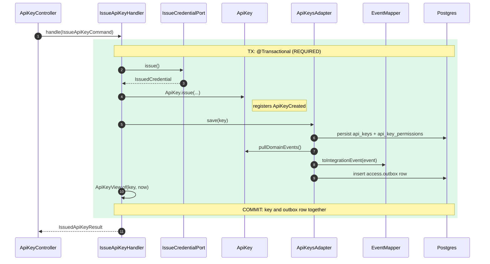

### Update and Delete: a new transaction for each attempt

Each attempt reads the key again, so the domain rules always decide against the current state. A conflict is only detected at commit, when the `UPDATE` or `DELETE ... WHERE lock_version = ?` matches no row. The commit then fails, `@Retryable` on `OptimisticLockRetry` runs the attempt again, and it gets a brand-new transaction. Delete follows the same steps but calls `key.delete(now)` and `apiKeys.delete(key)`.

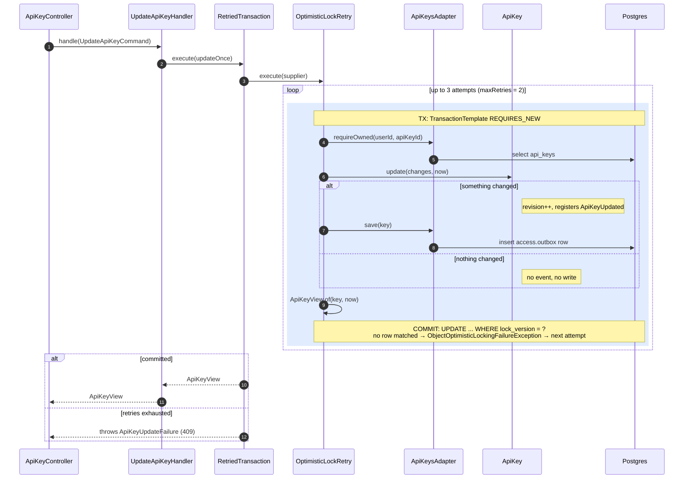

### Relay: one transaction per tick, with RabbitMQ outside it

The relay holds row locks while it publishes and waits for confirms (one deadline for the whole batch, `confirmTimeout`, 5 seconds by default). `SKIP LOCKED` lets another instance's relay take other rows in the meantime. RabbitMQ is not part of the transaction, so delivery is at-least-once:

- If the publish succeeds but the commit fails, the rows stay pending and are sent again.
- On an outage (the stream cannot be declared, a send fails, the deadline passes, a confirm fails for a connection reason) the transaction rolls back: nothing is stamped or counted, and messages already confirmed in that tick are sent again by the next one.
- On an unpublishable payload (found while building the bodies) the batch is dropped before anything is sent: the transaction commits only the error on that row, then the relay halts.
- On a refusal the transaction commits the stamps of the confirmed rows and the error on the refused rows, then the relay halts. Nothing is retried.

Consumers keep the highest `version` per key and can dedupe on `eventId`.

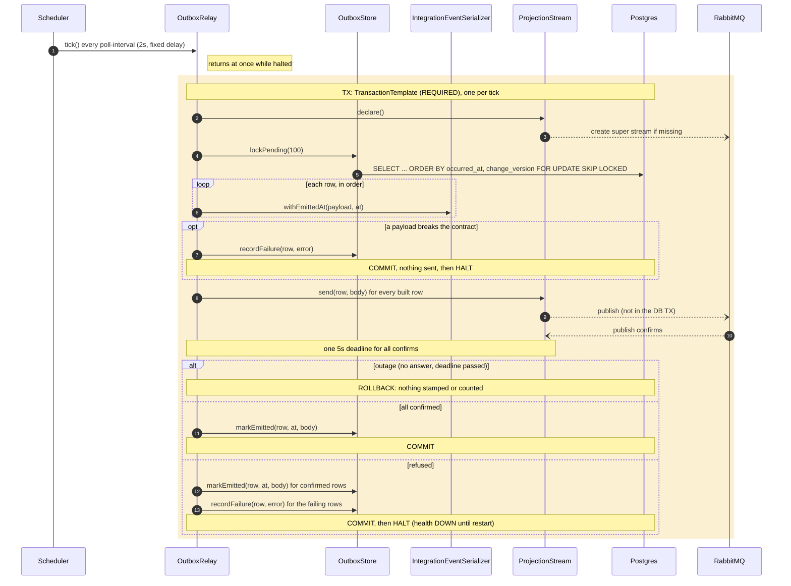

## Class-level detail

The rest of the page zooms in to individual classes, one flow at a time:

1. [Owner API](#1-owner-api-issue-get-update-delete): issuing, reading, updating and deleting a key, up to the outbox insert.
2. [Verification](#2-verification): how other modules check a presented credential.
3. [Key formats](#3-key-formats): how credentials are generated and hashed.
4. [Outbox relay](#4-outbox-relay): how outbox rows reach RabbitMQ.
5. [Domain model](#5-domain-model): what goes on inside the `ApiKey` aggregate.
6. [Errors](#6-errors): which exception becomes which HTTP response.

`ApiKey` and `ApiKeys` appear without members in diagrams 1 to 4. Their members are listed in diagram 5.

All paths are under `backend/src/main/java/me/dhiren9939/backend/`.

## 1. Owner API (issue, get, update, delete)

The controller turns each request into a command or query and hands it to a use case. Handlers that write wrap their work in `RetriedTransaction`, so if an optimistic-lock conflict occurs, the key is read again and the domain rules run again against its current state. Each `ApiKeys.save` or `ApiKeys.delete` also writes the key's pending events to the outbox in the same transaction.

```mermaid
classDiagram
    direction TB

    class ApiKeyController {
        +create(userId, CreateRequestDto) ResponseEntity
        +get(userId, apiKeyId) GetResponseDto
        +update(userId, apiKeyId, UpdateRequestDto) GetResponseDto
        +delete(userId, apiKeyId) ResponseEntity
    }

    class IssueApiKeyUseCase {
        <<interface>>
        +handle(IssueApiKeyCommand) IssuedApiKeyResult
    }
    class GetApiKeyUseCase {
        <<interface>>
        +handle(GetApiKeyQuery) ApiKeyView
    }
    class UpdateApiKeyUseCase {
        <<interface>>
        +handle(UpdateApiKeyCommand) ApiKeyView
    }
    class DeleteApiKeyUseCase {
        <<interface>>
        +handle(DeleteApiKeyCommand) void
    }

    class IssueApiKeyHandler
    class GetApiKeyHandler
    class UpdateApiKeyHandler
    class DeleteApiKeyHandler

    class RetriedTransaction {
        +execute(Supplier~T~) T
        +execute(Runnable) void
    }
    class OptimisticLockRetry {
        +execute(Supplier~T~) T
    }
    class IssueCredentialPort {
        <<interface>>
        +issue() IssuedCredential
    }
    class Lifetime {
        <<enumeration>>
        +expiryFrom(now) Instant
    }
    class ApiKeyView {
        <<record>>
        +of(ApiKey, now)$ ApiKeyView
    }
    class IssuedApiKeyResult {
        <<record>>
        key ApiKeyView
        accessSecret String
    }
    class ApiKeys {
        <<interface>>
    }
    class ApiKey {
        <<aggregate>>
    }

    ApiKeyController --> IssueApiKeyUseCase : handle(IssueApiKeyCommand)
    ApiKeyController --> GetApiKeyUseCase : handle(GetApiKeyQuery)
    ApiKeyController --> UpdateApiKeyUseCase : handle(UpdateApiKeyCommand)
    ApiKeyController --> DeleteApiKeyUseCase : handle(DeleteApiKeyCommand)

    IssueApiKeyHandler ..|> IssueApiKeyUseCase
    GetApiKeyHandler ..|> GetApiKeyUseCase
    UpdateApiKeyHandler ..|> UpdateApiKeyUseCase
    DeleteApiKeyHandler ..|> DeleteApiKeyUseCase

    IssueApiKeyHandler --> IssueCredentialPort : issue()
    IssueApiKeyHandler --> Lifetime : expiryFrom(createdAt)
    IssueApiKeyHandler --> ApiKey : ApiKey.issue(...)
    IssueApiKeyHandler --> ApiKeys : save(key)
    IssueApiKeyHandler ..> IssuedApiKeyResult : creates

    GetApiKeyHandler --> ApiKeys : requireOwned(userId, apiKeyId)

    UpdateApiKeyHandler --> RetriedTransaction : execute(work)
    UpdateApiKeyHandler --> ApiKeys : requireOwned() / save(key)
    UpdateApiKeyHandler --> ApiKey : update(changes, now)

    DeleteApiKeyHandler --> RetriedTransaction : execute(work)
    DeleteApiKeyHandler --> ApiKeys : requireOwned() / delete(key)
    DeleteApiKeyHandler --> ApiKey : delete(now)

    IssueApiKeyHandler --> ApiKeyView : of(key, now)
    GetApiKeyHandler --> ApiKeyView : of(key, now)
    UpdateApiKeyHandler --> ApiKeyView : of(key, now)
    ApiKeyView --> ApiKey : getters / state(now)

    RetriedTransaction --> OptimisticLockRetry : execute(supplier)
```

### Saving a key writes its events to the outbox

Diagram 1 stops at the `ApiKeys` port. `ApiKeysAdapter` implements that port. When it saves or deletes a key, it also drains the key's domain events, maps each one to the published integration event and hands it to `OutboxStore.append`, which serializes it (checking it against the contract) and inserts the row. All of this happens in the caller's transaction, so a serialization failure rolls the key change back.

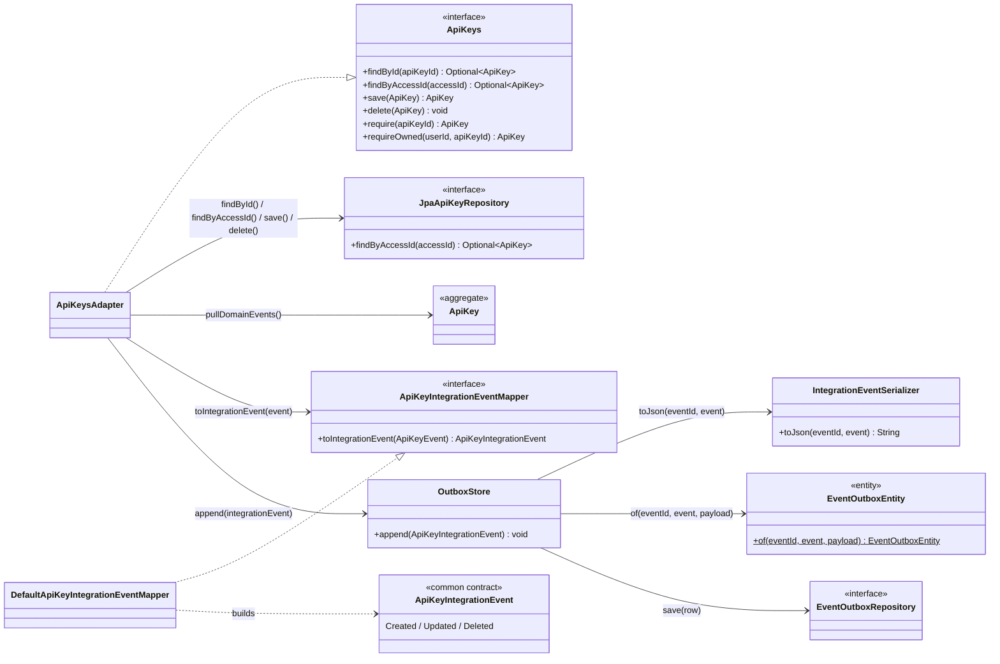

## 2. Verification

Other modules depend only on `ApiKeyVerificationFacade`, which lives in `common/access`. The facade never throws on a rejected credential: it converts `ApiKeyVerificationFailure` into a `Failure` result. The arrows from the handler are numbered in the order the handler runs them. The secret is checked before expiry, so a caller who doesn't hold the right secret can't tell an unknown access ID from a wrong secret.

The facade is internal: only other services and the API gateway call it. But the credential it carries is relayed from a client, so Access treats it as untrusted:

- **`ParsedApiKey.parse`** only reads the key format from the Access ID prefix (`V`, 1 to 3 digits, `_`), with an anchored match that never scans the rest of the input. No prefix means `MALFORMED_CREDENTIALS`.
- **The key format owns the shape of its keys.** Right after `supports(format)`, the handler asks `CredentialVerifier.isWellFormed(accessId, secret)`, before the lookup and the hash. Anything else is `MALFORMED_CREDENTIALS`.
  - V1 (`V1KeyShape`, shared by the issuer and the verifier): `V1_` plus 22 characters, and a 43-character secret, all in the `SortableEncoder` alphabet.
  - The lengths are derived from the encoding and compared first, so input of any size is refused at once.
- **Logging.** Every failure is one log line with the fixed message `API key verification failed` and key-value fields:
  - `event=apikey.verify.failed`;
  - `reason`: the code the caller gets;
  - `cause`, for operators: `malformed_credential`, `unsupported_key_format`, `unknown_access_id`, `secret_mismatch` or `key_expired`;
  - `accessId` and `keyFormat`;
  - for a malformed credential, `accessIdLength` and `accessSecretLength` instead of the key format.
- **Safe values.** The caller's input is never in the message. Every logged identifier goes through `LoggedIdentifier`, which turns anything outside `A-Z a-z 0-9 _ -` into `?` and cuts it at 64 characters. The secret is never logged.
- **Console.** It keeps the readable pattern, with the fields appended by `%kvp` (`logging.pattern.console`).
- **The gateway** owns transport limits (header and body size) and rate limiting; Access has no generic input ceiling and no rate limit.

```mermaid
classDiagram
    direction TB

    class ApiKeyVerificationFacade {
        <<interface>>
        +verifyApiKey(VerifyApiKeyQuery) ApiKeyVerifyResult
    }
    class ApiKeyFacadeImpl
    class ApiKeyVerifyResult {
        <<sealed common contract>>
        Success(ApiKeyView)
        Failure(VerificationFailureCode, message)
    }
    class CommonApiKeyView["ApiKeyView (common)"] {
        <<record>>
        permissions Map of scope to level
    }
    class VerifyApiKeyUseCase {
        <<interface>>
        +handle(VerifyApiKeyQuery) VerifiedApiKey
    }
    class VerifyApiKeyHandler
    class ParsedApiKey {
        <<record>>
        +parse(accessId, accessSecret)$ ParsedApiKey
    }
    class LoggedIdentifier {
        +of(value)$ String
    }
    class CredentialVerifier {
        <<interface>>
        +supports(keyFormat) boolean
        +isWellFormed(accessId, accessSecret) boolean
        +matches(presentedSecret, storedSecretHash) boolean
    }
    class ApiKeys {
        <<interface>>
    }
    class ApiKey {
        <<aggregate>>
    }
    class VerifiedApiKey {
        <<record>>
    }
    class ApiKeyVerificationFailure {
        <<exception>>
        +malformed()$
        +invalid()$
        +expired()$
        +code() VerificationFailureCode
    }

    ApiKeyFacadeImpl ..|> ApiKeyVerificationFacade
    ApiKeyFacadeImpl --> VerifyApiKeyUseCase : handle(query)
    ApiKeyFacadeImpl ..> ApiKeyVerifyResult : Success / Failure
    ApiKeyFacadeImpl ..> CommonApiKeyView : creates
    ApiKeyFacadeImpl --> ApiKeyVerificationFailure : code() / getMessage()

    VerifyApiKeyHandler ..|> VerifyApiKeyUseCase
    VerifyApiKeyHandler --> ParsedApiKey : 1 parse(accessId, secret)
    VerifyApiKeyHandler --> CredentialVerifier : 2 supports(keyFormat)  3 isWellFormed(accessId, secret)  5 matches(secret, hash)
    VerifyApiKeyHandler --> ApiKeys : 4 findByAccessId(accessId)
    VerifyApiKeyHandler --> ApiKey : getAccessSecretHash()  6 canAuthenticate(now)
    VerifyApiKeyHandler ..> VerifiedApiKey : creates
    VerifyApiKeyHandler ..> ApiKeyVerificationFailure : throws invalid() / expired()
    VerifyApiKeyHandler ..> LoggedIdentifier : every logged accessId / keyFormat
    ParsedApiKey ..> ApiKeyVerificationFailure : throws malformed()
```

## 3. Key formats

`IssueCredentialPort` has no implementing class. `ApiKeyConfig.issueCredentialPort(...)` picks the `CredentialIssuer` whose format matches `access.key-format.current` (V1 by default) and returns that issuer's `issue` method as the port. To verify a credential, the use case asks every `CredentialVerifier` bean whether it `supports` the presented format.

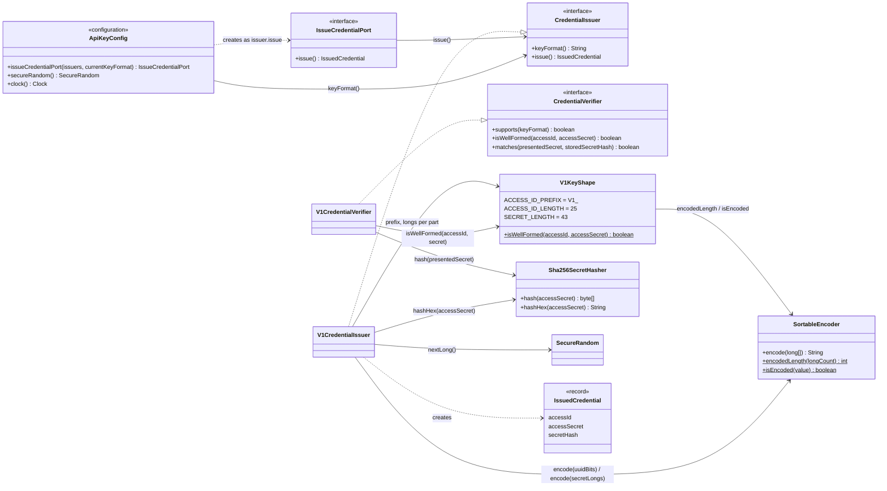

## 4. Outbox relay

Diagram 1 shows how rows get into the outbox. This diagram shows how they get out. Every `poll-interval` (2 seconds, fixed delay), `OutboxRelay.tick()` runs one batch in its own transaction. It declares the `apikey.projections` super stream, locks up to 100 pending rows with `FOR UPDATE SKIP LOCKED`, builds each body with `IntegrationEventSerializer.withEmittedAt` (one `emittedAt` per tick, truncated to microseconds so the column and the JSON match), sends them all (partitioned by `apiKeyId`) and waits for the publish confirms against one deadline for the whole batch. Then it stamps confirmed rows with the exact body that was sent. An outage rolls the tick back; a refused row is recorded on the row and halts the relay until restart. A payload that breaks the contract drops the whole batch before anything is sent, is recorded on its row and halts the relay. `OutboxRelayConfig` wires these beans.

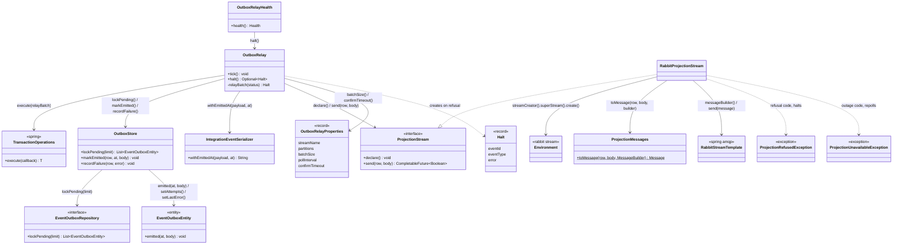

How a send ends, as `RabbitProjectionStream` reports it to the relay:

| Template answer | Port answer | Relay does |
|---|---|---|
| confirmed | `true` | stamps the row |
| `StreamSendException` with an outage code: `MESSAGE_ENQUEUEING_FAILED` (10001), `PRODUCER_NOT_AVAILABLE` (10002), `PRODUCER_CLOSED` (10003), `PUBLISH_CONFIRM_TIMEOUT` (10004), `STREAM_DOES_NOT_EXIST` (2), `STREAM_NOT_AVAILABLE` (6), `INTERNAL_ERROR` (15), `PUBLISHER_DOES_NOT_EXIST` (18, the reconnect race) | exceptional, `ProjectionUnavailableException` | outage: rolls the tick back, repolls next tick |
| `StreamSendException` with any other code, e.g. `ACCESS_REFUSED` (16), `PRECONDITION_FAILED` (17), `NO_ROUTE_FOUND` (10005) | exceptional, `ProjectionRefusedException` | refusal: records the error on the row and halts |
| any other exception, or no answer before the timeout | exceptional (`ProjectionUnavailableException`) / timeout | outage |

Messages name the code (`ACCESS_REFUSED (16)`). An outage logs one WARN line per tick (events cancelled, nothing marked, when it retries, why). A halt logs one ERROR block: the event, its key and version, the reason, what happened to the batch, and how to recover.

## 5. Domain model

Callers state what they want through the aggregate's commands; it has no setters. Each command bumps `revision` and registers a full-snapshot event, and `ApiKeysAdapter` collects those events with `pullDomainEvents()`. `Permissions` is immutable and holds one level per scope. Each `Scope` decides which levels it accepts.

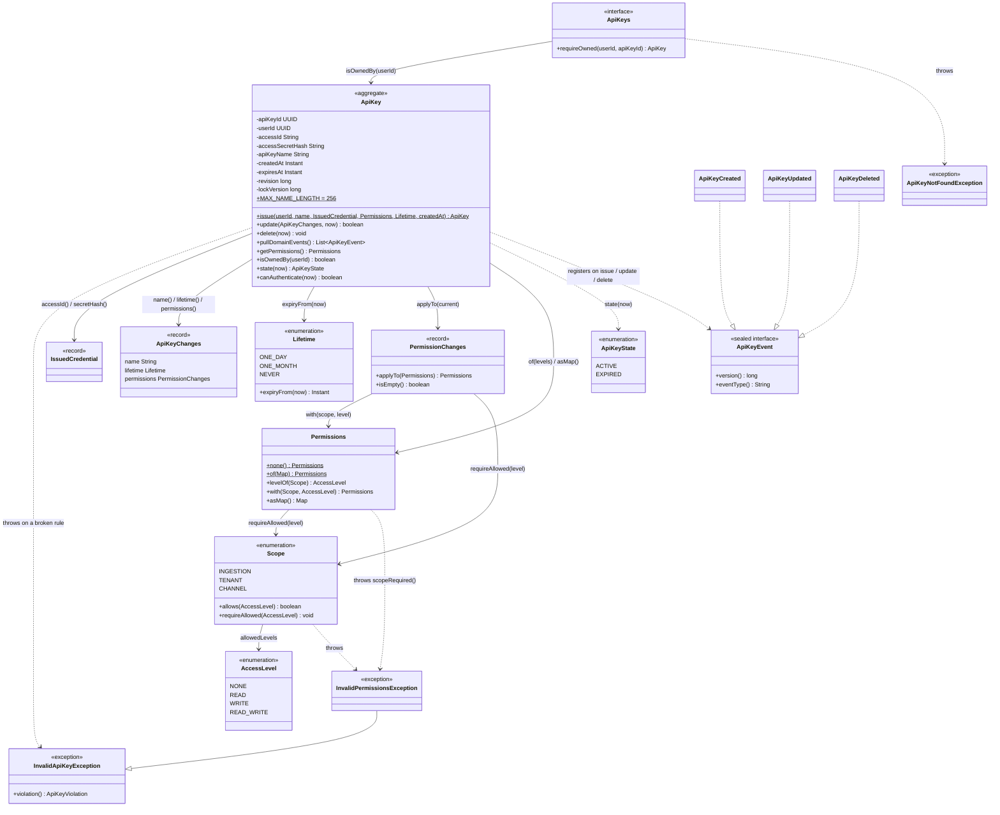

## 6. Errors

The aggregate checks every rule a caller can break itself, whoever calls it (HTTP, a facade, another service), and refuses with `InvalidApiKeyException` before changing anything. Its `ApiKeyViolation` (`USER_REQUIRED`, `NAME_REQUIRED`, `NAME_BLANK`, `NAME_TOO_LONG`, `NAME_INVALID_CHARACTERS`, `EXPIRY_REQUIRED`, `PERMISSIONS_REQUIRED`, `PERMISSION_SCOPE_REQUIRED`, `INVALID_SCOPE_LEVEL`) uses the same code as the request DTO for the same rule, and the DTOs share `ApiKey.MAX_NAME_LENGTH`. Values only server code supplies (the credential, the clock's instant) and the event contract (`ApiKeyEventRules`, `IntegrationEventRules`) fail with `NullPointerException` / `IllegalArgumentException`: those are bugs, so they stay logged 500s and are never mapped to 400.

Domain and application exceptions are allowed to propagate all the way up. `ApiKeyExceptionHandler` maps them to RFC 9457 problem responses that include a machine-readable `code`. `WebExceptionHandler` catches framework errors (validation, unreadable body, type mismatch) and anything else that is left.

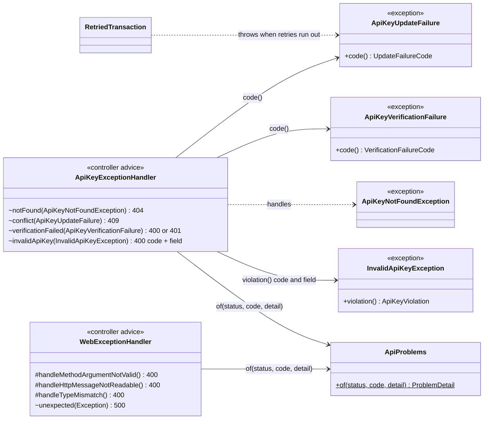

## The published contract

One body per event, checked in one place, pinned by golden files:

- **`IntegrationEventSerializer`** checks every body it writes to the outbox and again before it is published, in three steps:
  1. **Keys.** Exactly `STORED_KEYS`, derived from the event records' components (all but `emittedAt`) plus `eventId` and `eventType`. The class refuses to load if the three records ever carry different fields.
  2. **JSON form, from each component's type.** Text for `String`, a canonical lower-case UUID for `UUID`, a canonical ISO-8601 UTC instant for `Instant`, a whole number for `long`, and an object of known scope to level, by wire name, for the permissions. A component of a new type fails until the serializer learns its form.
  3. **Values.** The body is read back into its contract record, so `IntegrationEventRules` decides. The serializer repeats no size or value rule.
- **`JsonApiKeyIntegrationEventDeserializer`** reads a published body back through the same three steps (via the serializer's `validate`), after checking and removing `emittedAt`, which a published body must carry. It throws `ApiKeyEventDeserializationException` naming the field. `JsonApiKeyIntegrationEventDeserializerTest` reads `create.published.json`, round-trips every event type and checks the refusals.
- **Wire names.** `ApiKeyScope` and `ApiKeyAccessLevel` have a fixed `wireName()` and `fromWire()`. Renaming a Java constant never changes what consumers see.
- **Golden files.** `backend/src/test/resources/contracts/apikey.projection/` holds `create.json`, `update.json`, `delete.json` (stored bodies) and `create.published.json` (with `emittedAt`). `ApiKeyProjectionGoldenContractTest` checks that:
  - the serializer writes exactly these bodies;
  - publishing adds only `emittedAt`;
  - every golden has exactly `STORED_KEYS`;
  - dropping or adding any key is refused;
  - every scope and level appears by its wire name.

  Consumers (Ingestion's reader) test against the same files, so a field added on one side only fails a test, not production. Changing a golden file is a contract change.
- **`ApiKeyEventRules`** stays in the domain on purpose, as a safety net. The domain may not use `common`, and the aggregate already checks its inputs.

## What is not reusable across contexts

The outbox relay, `OutboxStore` and the outbox tables belong to Access alone: they read `access.outbox` and publish to `apikey.projections`. When Subscriptions needs to publish events, copy the pattern (an outbox row written in the same transaction, a strict serializer in front of it, a relay with publisher confirms that halts on a row it cannot publish), not the classes.
