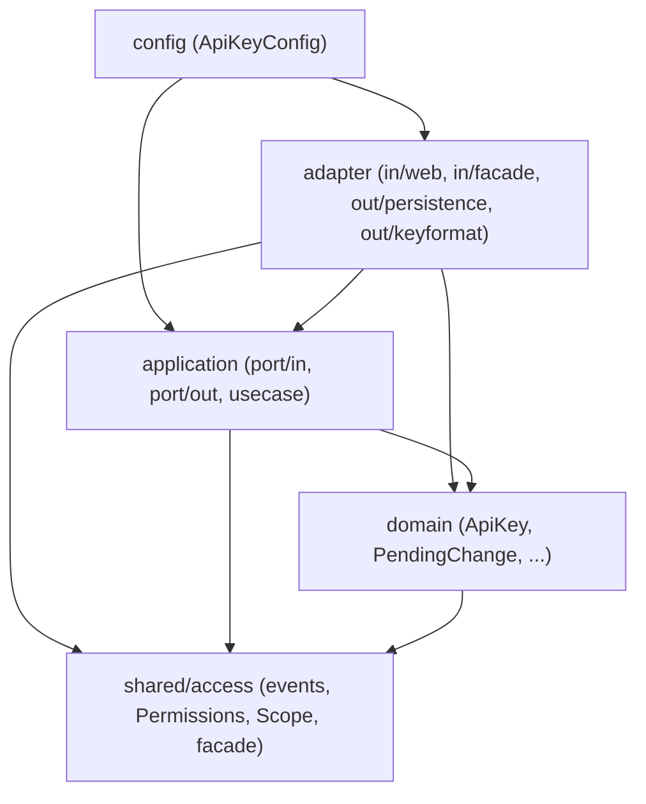
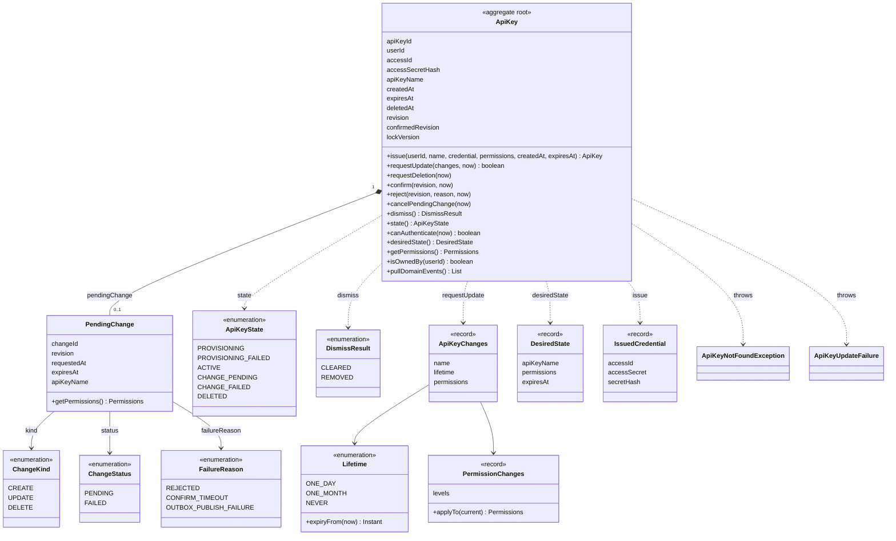
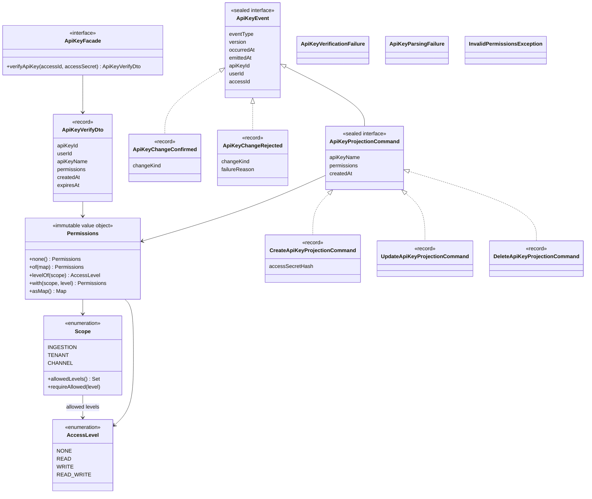
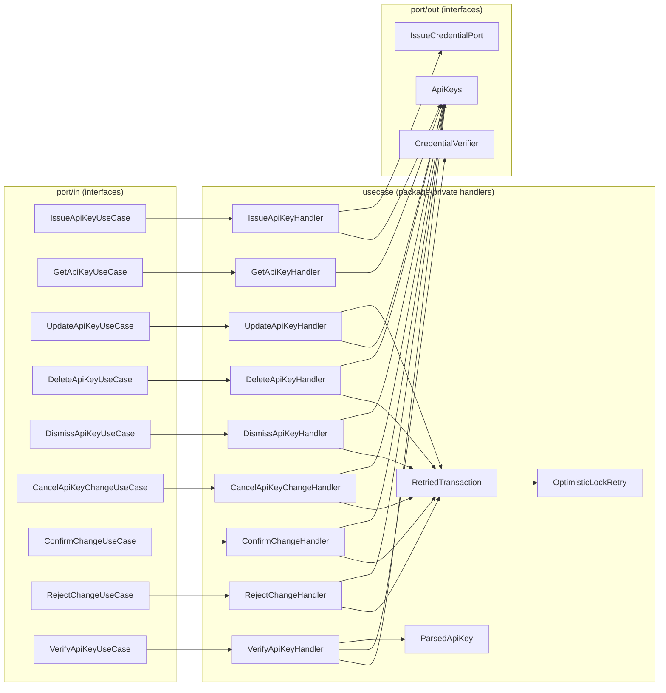
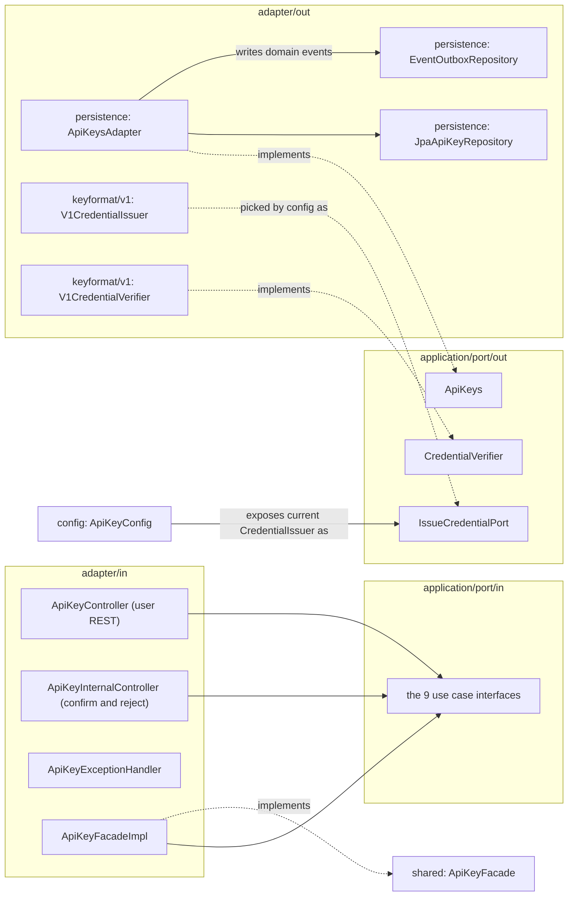
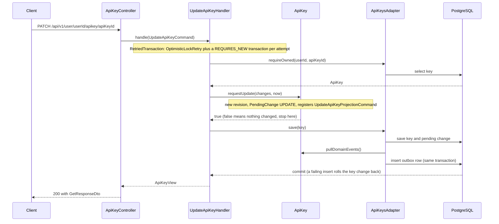
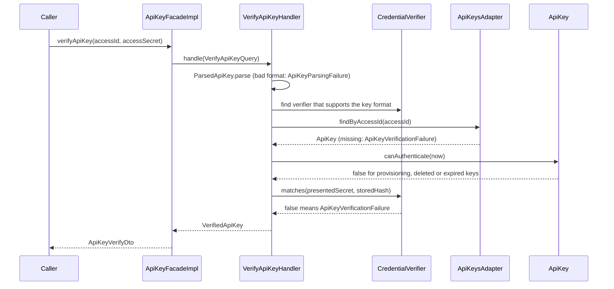

# Access: class structure

A map of the code for the Access context (API keys). For the vocabulary and rules, see
[access-context.md](access-context.md); for what the tests check, see [access-tests.md](access-tests.md).
Everything below was checked against the source under `backend/src/main/java/me/dhiren9939/backend`.

## How to read the code

1. Start at **`access/domain/ApiKey.java`**. It is the whole business: a key is issued, changed, confirmed or
   rejected by the data plane, dismissed and deleted through its methods. It has no setters.
2. `access/application/port/in` lists what the outside world can ask for: one `*UseCase` interface per operation,
   with a command or query record.
3. `access/application/usecase` holds one small `*Handler` per use case. A handler loads the key, calls one
   method on it, saves it. It holds no business rules.
4. `access/application/port/out` lists what Access needs from outside: `ApiKeys` (storage),
   `IssueCredentialPort` (make a new credential), `CredentialVerifier` (check a secret).
5. `access/adapter` holds the Spring/JPA/HTTP code that plugs into those ports: `in/web` (REST controllers),
   `in/facade` (in-process verify), `out/persistence` (database + outbox), `out/keyformat` (credential format V1).
6. `shared/access` is the published contract other contexts may use: events, `Permissions`, `Scope`,
   `AccessLevel`, the facade and its failures. It has no Spring, JPA or JSON dependencies.
7. `access/config/ApiKeyConfig.java` creates the `Clock`, `SecureRandom`, and picks the current key format.

**Dependency rule:** `adapter` -> `application` -> `domain` -> `shared`. Nothing points back. `ArchitectureTest`
fails the build if it does. The one framework the domain may import is `jakarta.persistence` (the aggregate is a
JPA entity).

## 1. Layers and allowed dependencies



An arrow means "may depend on". `application` never depends on `adapter` or `config`; inbound adapters never
depend on outbound adapters; `shared` never depends on `access`.

## 2. Domain (`access/domain`)



How the pieces fit: `confirmedRevision` and the plain fields (`apiKeyName`, permissions, `expiresAt`) hold the
**confirmed** state. A requested change lives in `PendingChange` until the data plane confirms it. `state()` is
derived from `deletedAt` and the pending change; it is never stored. `revision` is the change counter carried
as `version` in events. `ApiKeyNotFoundException` and `ApiKeyUpdateFailure` are plain runtime exceptions.

## 3. Shared contracts (`shared/access`)



The three failures (`ApiKeyVerificationFailure`, `ApiKeyParsingFailure`, `InvalidPermissionsException`) are
plain runtime exceptions. `ApiKeyProjectionCommand` is sealed: only the three records may implement it. The events carry no
expiry; `occurredAt` is when the change reached the outbox, `emittedAt` is null until something publishes it.

## 4. Application layer (`access/application`)

Each row of the diagram is one operation: HTTP or facade -> input port -> handler -> output ports.



Inputs and outputs of each use case (all in `port/in`, all records):

| Use case | Takes | Returns |
|---|---|---|
| `IssueApiKeyUseCase` | `IssueApiKeyCommand(userId, name, lifetime, permissions)` | `IssuedApiKeyResult(key, accessSecret)`: the only place the secret appears |
| `GetApiKeyUseCase` | `GetApiKeyQuery(userId, apiKeyId)` | `ApiKeyView` (no secrets, includes `state` for internal use; the HTTP response exposes only `updateStatus`) |
| `UpdateApiKeyUseCase` | `UpdateApiKeyCommand(userId, apiKeyId, name, lifetime, permissions)` | `ApiKeyView` |
| `DeleteApiKeyUseCase` | `DeleteApiKeyCommand(userId, apiKeyId)` | nothing |
| `DismissApiKeyUseCase` | `DismissApiKeyCommand(userId, apiKeyId)` | nothing |
| `CancelApiKeyChangeUseCase` | `CancelApiKeyChangeCommand(userId, apiKeyId)` | nothing |
| `ConfirmChangeUseCase` | `ConfirmChangeCommand(apiKeyId, revision)` | nothing |
| `RejectChangeUseCase` | `RejectChangeCommand(apiKeyId, revision, reason)` | nothing |
| `VerifyApiKeyUseCase` | `VerifyApiKeyQuery(accessId, accessSecret)` | `VerifiedApiKey` |

Notes: `GetApiKeyHandler` and `VerifyApiKeyHandler` run in read-only transactions and `IssueApiKeyHandler` is
`@Transactional`. Every handler that changes an existing key (Update, Delete, Dismiss, CancelChange, ConfirmChange, RejectChange)
goes through `RetriedTransaction`: a fresh `REQUIRES_NEW` transaction per attempt, retried through
`OptimisticLockRetry` when another writer changed the key first. Each retry re-reads the key, so the domain rules
decide the outcome against its current state. When retries run out the caller gets `ApiKeyUpdateFailure` (409).
`ParsedApiKey` is an internal record that splits `V1_xxx` into access ID, secret and key format.

## 5. Adapters (`access/adapter`, `access/config`)



`V1CredentialIssuer` implements `CredentialIssuer` (adapter-local interface), not `IssueCredentialPort` directly:
`ApiKeyConfig` picks the issuer whose `keyFormat()` equals `access.key-format.current` (default `V1`) and exposes
it as the single `IssueCredentialPort` bean. `ApiKeyExceptionHandler` maps exceptions to HTTP: not found 404,
update failure 409, verification failure 401, parsing failure and invalid permissions 400.

## 6. Sequence: update an API key



## 7. Sequence: verify an API key



Every non-authenticatable case throws `ApiKeyVerificationFailure` with the same message, so a caller cannot
tell an unknown key from a wrong secret.

## 8. Package tree (every class)

```
me.dhiren9939.backend
├── BackendApplication                      Spring Boot entry point
├── shared/access/                          published contracts (no framework dependencies)
│   ├── AccessLevel                         NONE, READ, WRITE, READ_WRITE
│   ├── Scope                               INGESTION, TENANT, CHANNEL and the levels each accepts
│   ├── Permissions                         immutable scope-to-level map; missing scope = NONE
│   ├── InvalidPermissionsException         a level its scope does not accept
│   ├── ApiKeyFacade                        in-process "verify this credential" entry point
│   ├── ApiKeyVerifyDto                     result of a successful verification
│   ├── ApiKeyVerificationFailure           could not authenticate (always the same message)
│   ├── ApiKeyParsingFailure                access ID is not in the expected format
│   └── events/
│       ├── ApiKeyProjectionCommand                     sealed interface of the three lifecycle events
│       ├── CreateApiKeyProjectionCommand                   revision requested for a new key (carries the secret hash)
│       ├── UpdateApiKeyProjectionCommand                   revision requested for a changed key
│       └── DeleteApiKeyProjectionCommand                   revision requested for a deleted (or failed-creation) key
└── access/
    ├── domain/
    │   ├── ApiKey                          the aggregate: all lifecycle rules, JPA entity
    │   ├── PendingChange                   the one requested change waiting for the data plane
    │   ├── ApiKeyState                     derived lifecycle state
    │   ├── ChangeStatus                    PENDING, FAILED
    │   ├── DismissResult                   CLEARED or REMOVED
    │   ├── DesiredState                    state the key is heading for (pending, else confirmed)
    │   ├── Lifetime                        ONE_DAY, ONE_MONTH, NEVER and expiryFrom(now)
    │   ├── ApiKeyChanges                   optional name, lifetime, permission changes
    │   ├── PermissionChanges               partial scope-to-level update
    │   ├── IssuedCredential                access ID, one-time secret, secret hash
    │   └── ApiKeyNotFoundException / ApiKeyUpdateFailure
    ├── application/
    │   ├── port/in/                        8 *UseCase interfaces, their *Command/*Query records,
    │   │                                   ApiKeyView, IssuedApiKeyResult, VerifiedApiKey
    │   ├── port/out/                       ApiKeys, IssueCredentialPort, CredentialVerifier
    │   └── usecase/                        Issue/Get/Update/Delete/Dismiss/CancelChange/ConfirmChange/RejectChange/
    │                                       VerifyApiKey *Handler, RetriedTransaction, OptimisticLockRetry, ParsedApiKey
    ├── adapter/
    │   ├── in/web/                         ApiKeyController, ApiKeyInternalController, ApiKeyExceptionHandler,
    │   │                                   CreateRequestDto, UpdateRequestDto, RejectRequestDto,
    │   │                                   CreateResponseDto, GetResponseDto, GetPageResponseDto (unused)
    │   ├── in/facade/ApiKeyFacadeImpl      implements ApiKeyFacade via VerifyApiKeyUseCase
    │   ├── out/persistence/                ApiKeysAdapter, JpaApiKeyRepository, EventOutboxEntity,
    │   │                                   EventOutboxRepository
    │   └── out/keyformat/                  CredentialIssuer, Sha256SecretHasher, SortableEncoder,
    │                                       v1/V1CredentialIssuer, v1/V1CredentialVerifier
    └── config/ApiKeyConfig                 Clock, SecureRandom, selects the current key format
```

Database objects (schema `access`): `api_keys`, `pending_changes`, `api_key_permissions`,
`pending_change_permissions`, `outbox`. The hand-written reference SQL is
`backend/src/main/resources/db.migration/access/V1__create_access_schema.sql`.

## 9. Where do I change X?

| I want to... | Change |
|---|---|
| Add a permission scope (e.g. `MONITORING`) | One constant in `shared/access/Scope` with its allowed levels. Permissions, updates, storage, web and event payloads all work from the enum. `ScopeTest` checks the new constant automatically. |
| Add an event type | New record in `shared/access/events/domain`, add it to `ApiKeyEvent` (or `ApiKeyProjectionCommand`) `permits`, register it in `ApiKey`, add it to `EventOutboxEntity.of` (the compiler forces this) and add `EventOutboxEntity.from(...)`. Update `ApiKeyProjectionCommandContractTest` and `access-context.md`. |
| Add a use case | Command or query record and `*UseCase` in `application/port/in`, `*Handler` in `application/usecase`, a method on `ApiKey` if there is a rule, a controller method, and a handler test using `InMemoryApiKeys`. |
| Change the key format | Add `v2/V2CredentialIssuer` (implements `CredentialIssuer`) and `v2/V2CredentialVerifier` (implements `CredentialVerifier`), then set `access.key-format.current=V2`. Keep the V1 verifier so old keys still work. |
| Add or change an endpoint | A method in `adapter/in/web/ApiKeyController` mapping to a command, DTOs next to it, errors in `ApiKeyExceptionHandler`. Tests: `ApiKeyControllerTest` and `ApiKeyHttpIntegrationTest`. |
| Change the database schema | Edit the JPA mappings (`ApiKey`, `PendingChange`, `EventOutboxEntity`) **and** `V1__create_access_schema.sql`. The app itself uses `ddl-auto=update`; `SqlMigrationValidateIntegrationTest` fails if the SQL file and mappings disagree. |
| Change a business rule | `ApiKey` (or `PermissionChanges` / `Permissions`). Handlers should not need to change. |
