# Access

Ubiquitous language, rules, code map and tests for the Access context (supporting subdomain, control plane). It issues API keys and propagates them to the data plane (Ingestion) by control events. This is the single Access document; see [context-map.md](context-map.md) for how the context fits with the others.

## Vocabulary

| Term | Meaning |
|---|---|
| **API Key** | The aggregate. |
| **Owner** | The user (`userId`) who owns the key. Only the owner can read or change it. |
| **Access ID** | Public identifier, prefixed with the key format (e.g. `V1_...`). Safe to log. |
| **Secret** | Exists only at issuance, shown once, never stored. |
| **Secret Hash** | Stored form of the secret; propagated to the data plane. |
| **Credential** | Access ID + Secret. What a caller presents. |
| **Key Format** | `V1`, `V2`, ... Selects the generator/verifier. |
| **Issued Credential** | accessId + secret + hash, produced at issuance. Replaces `ApiKeyTriplet`. |
| **Name** | Owner-chosen label. |
| **Scope** | A resource area a key can be granted access to: `INGESTION`, `TENANT`, `CHANNEL`. Each scope lists the levels it accepts. |
| **Access Level** | `NONE` / `READ` / `WRITE` / `READ_WRITE`. `INGESTION` accepts only `NONE` and `WRITE`. |
| **Permissions** | An immutable map of scope to access level. A scope that is not present means `NONE`. Never contains nulls; equality ignores explicit `NONE`. |
| **Permission Changes** | A partial map: only the listed scopes change, an empty map changes nothing. Distinct from Permissions. |
| **Lifetime** | `ONE_DAY` / `ONE_MONTH` / `NEVER`. Replaces `ApiKeyExpiry.Duration`. |
| **Expiry** | An instant; null means never. Changing the lifetime restarts it from now. |

### Versioning

| Term | Meaning |
|---|---|
| **Key Format** | Credential scheme (`V1`). Not a change counter. |
| **Revision** | Single change counter: 1 at issuance, +1 per change. Merges old `issuedVersion` and `desiredVersion`. This is the `version` in events. |
| **Confirmed Revision** | Highest revision the data plane confirmed. 0 = never provisioned. Old `appliedVersion`. |
| **Lock version** | JPA optimistic locking; infrastructure only, not domain. |

### Changes

| Term | Meaning |
|---|---|
| **Pending Change** | At most one per key. Was `ApiKeyNextEntity`. |
| **Change Kind** | `CREATE` / `UPDATE` / `DELETE`. |
| **Change Status** | `PENDING` / `FAILED`. |
| **Propagation** | The aggregate registers the control event; `ApiKeysAdapter` writes it to the outbox in the same transaction (see Outbox below). |
| **Confirm / Reject** | Data plane's answer for a specific revision. Confirm applies the change; reject marks it failed. |
| **Dismiss** | The owner acknowledges that they understand the state of their key: it clears a failed change, or removes a key that is finished (`PROVISIONING_FAILED`, `DELETED`). It never emits anything; compensating commands go out when the change fails. Replaces user-facing "acknowledgeFailure". Nothing disappears without a dismiss. |
| **Cancel** | The owner withdraws a change that is still pending. It fails with `CANCELLED_BY_USER` and is compensated at once, like any failure. |
| **Incoming events** | What the data plane sends back, as plain records in `common/access/events/inbound`: `ApiKeyChangeConfirmed(apiKeyId, version, issuer)` (it applied that revision) and `ApiKeyChangeRejected(apiKeyId, version, issuer, failureReason)` (that revision failed, with a common `ApiKeyChangeFailureReason`). They are the inputs of `ConfirmChangeUseCase` and `RejectChangeUseCase`; the internal HTTP controller builds them from the path and body. `issuer` is a string naming the downstream service that answered, like the `iss` claim of a JWT. It is validated (required, non-blank) and logged, not persisted. With more than one downstream service, the confirm and reject use cases are where "every issuer has answered" would be enforced. Access does not emit them and writes nothing to the outbox for them. A reject does emit the compensating projection command. |
| **Compensating command** | Emitted the moment a change fails, at the next revision, because the data plane may have applied it anyway: failed create -> the domain registers a delete event, published as `DeleteApiKeyProjectionCommand`; failed update -> an update event restating the confirmed state, published as `UpdateApiKeyProjectionCommand`; failed delete -> a create event restoring the key (it carries the secret hash, so it also works when the key is gone downstream), published as `CreateApiKeyProjectionCommand`. |
| **Deleted (tombstone)** | A confirmed delete. The key stays visible, cannot authenticate, and accepts no changes until the owner dismisses it. |
| **Failure Reason** | The domain's `FailureReason` has exactly four values: `REJECTED` (data plane nack), `CONFIRM_TIMEOUT` (no confirm/reject in time), `OUTBOX_PUBLISH_FAILURE`, `CANCELLED_BY_USER`. The data plane sends the matching names as `common`'s `ApiKeyChangeFailureReason`; only `RejectChangeHandler` maps one to the other. |

## Commands

- **Issue**: create a key; revision 1, pending `CREATE`.
- **Update**: change name, permissions and/or lifetime; next revision, pending `UPDATE`.
- **Delete**: next revision, pending `DELETE`.
- **Dismiss**: acknowledge a failed or finished key; emits nothing.
- **Cancel**: withdraw the pending change (fails it as `CANCELLED_BY_USER`).
- **Confirm(revision)**: data plane confirms that revision.
- **Reject(revision, reason)**: data plane rejects that revision.

## States

States are derived from the confirmed state and the pending change; they are not stored.

| State | Meaning |
|---|---|
| `PROVISIONING` | Creation pending. Owner can read it via GET; it cannot authenticate. |
| `PROVISIONING_FAILED` | Creation failed. |
| `ACTIVE` | Confirmed, no pending change. |
| `CHANGE_PENDING` | Update/delete awaiting confirmation. |
| `CHANGE_FAILED` | Update/delete failed; awaiting dismiss. Dismiss returns the key to `ACTIVE`. |
| `DELETED` | Delete confirmed. Tombstone: visible to the owner, cannot authenticate, awaiting dismiss. |

`EXPIRED` is a time-based condition independent of state: any key past its Expiry cannot authenticate.

```
 Issue --> PROVISIONING --confirm--> ACTIVE <---------------------+
               |                      |  ^                       |
          fail |               update/|  | confirm / dismiss     |
               v                delete|  |                       |
        PROVISIONING_FAILED           v  |                       |
               |               CHANGE_PENDING --fail--> CHANGE_FAILED
       dismiss |                      |                    |
               v                      | confirm(DELETE)    | dismiss
      removed + DeleteApiKeyProjectionCommand         v                    +--> ACTIVE
                                    DELETED --dismiss--> removed (no event)
```

"fail" means reject, `CONFIRM_TIMEOUT`, `OUTBOX_PUBLISH_FAILURE` or `CANCELLED_BY_USER`, and each one emits the compensating command immediately. Dismiss (shown in the diagram) only acknowledges.

## Behaviour decisions

- The owner **can** read a provisioning key.
- A change that fails (reject, timeout, outbox failure or user cancel) emits its compensating command **immediately**, at the next revision, so the event stream stays consistent if the downstream service had actually applied it. Dismissing only records that the owner has seen the failure and emits nothing.
- A confirm that arrives after the change already failed is refused (409), because the revision is no longer pending.
- A confirmed delete does **not** remove the key. It becomes a visible `DELETED` tombstone and only the owner's dismiss removes it. That dismiss emits no event, because `DeleteApiKeyProjectionCommand` was already published when the delete was requested. A failed delete follows the normal failed-change path (`CHANGE_FAILED`, dismiss returns to `ACTIVE`).
- The Access ID stays reserved until the tombstone is dismissed.
- `CreateApiKeyProjectionCommand`, `UpdateApiKeyProjectionCommand`, `DeleteApiKeyProjectionCommand` carry the type strings (`apiKey.projection.create`, `apiKey.projection.update`, `apiKey.projection.delete`). They mean "revision N was requested and must be provisioned", not "took effect". Monitoring and Ingestion depend on them.

## Invariants

1. The secret is never stored.
2. At most one pending change per key. A failed change must be dismissed before any new change. The exceptions are dismissing a failed creation and dismissing a `DELETED` tombstone (both remove the key and emit nothing). A `DELETED` key accepts no update or delete.
3. Verification uses confirmed state only. Provisioning keys cannot authenticate; a key with a pending update authenticates with the old permissions until confirmed.
4. Confirm/reject must name the pending revision; mismatches are refused.
5. An update that changes nothing creates no pending change and no event.
6. Only the owner can read or change a key.
7. Permissions never contain null, and every level is one its scope accepts (otherwise HTTP 400).
8. Verification failures carry a machine-readable `VerificationFailureCode` and an end-user-safe message. Unknown Access IDs and wrong secrets are one outcome (`INVALID_CREDENTIALS`); the secret is checked before the key's state, so `KEY_EXPIRED`, `KEY_DELETED` and `KEY_NOT_ACTIVE` are only revealed to someone who holds the right secret (no enumeration).

## Renames from old code

| Old | New |
|---|---|
| API Key (context) | Access (package `me.dhiren9939.backend.access`) |
| `ApiKeyEntity` | `ApiKey` aggregate (`domain.aggregates.apikey`), no setters, behaviour methods |
| `ApiKeyTriplet` | `IssuedCredential` (`domain.aggregates.apikey`) |
| `ApiKeyExpiry` service + `ApiKeyExpiry.Duration` | `Lifetime` enum with `expiryFrom(now)`, pure domain (`domain.aggregates.apikey`) |
| `ApiKeyNextEntity` / `ApiKeyNextRepository` | `PendingChange`, owned by `ApiKey` (cascade, orphan removal), no repository |
| `ApiKeyUpdateType` (`CREATION`, `UPDATE`, `DELETE`) | `ChangeKind` (`CREATE`, `UPDATE`, `DELETE`; in `domain.aggregates.apikey`) |
| `ApiKeyUpdateStatus` | `ChangeStatus` |
| `ApiKeyFailureReason` (`OUTBOX`, `NACK`, `TIMEOUT`) | Domain `FailureReason` (`OUTBOX_PUBLISH_FAILURE`, `REJECTED`, `CONFIRM_TIMEOUT`, plus new `CANCELLED_BY_USER`; in `domain.aggregates.apikey`), with a separate `common` `ApiKeyChangeFailureReason` for the incoming reject wire values |
| `issuedVersion` + `desiredVersion` | `revision` |
| `appliedVersion` | `confirmedRevision` |
| (new) | `deletedAt` (tombstone), derived `ApiKeyState` |
| `new Permissions(null, null, null)` used as a patch | `ApiKeyChanges` + `PermissionChanges` (`domain.aggregates.apikey`) |
| `Permissions(ingestionPermission, tenantPermission, channelPermission)` record with `@Embeddable` | `Permissions` map-form value object (`domain.aggregates.apikey`, no JPA) over `Scope` -> `AccessLevel` |
| `ApiKeyPermissions.Ingestion` / `.Tenant` / `.Channel` enums | `Scope` enum (declares its allowed levels) + one `AccessLevel` enum (both in `domain.aggregates.apikey`) |
| `ApiKeyRepository` (Spring Data) | `ApiKeys` (`domain.repositories`), `ApiKeysAdapter` + `JpaApiKeyRepository` (`infrastructure.persistence.repositories`) |
| `ApiKeyEventEmitterService` | removed; the aggregate registers domain events, `ApiKeysAdapter` (`infrastructure.persistence.repositories`) maps them with `ApiKeyProjectionMapper` and writes the outbox rows |
| `ApiKeyConfig` | `infrastructure.config.ApiKeyConfig` |
| `Sha256SecretHasher`, `SortableEncoder` | `infrastructure.keyformat` |
| `ApiKeyCreationProviderV1` + `ApiKeyCreationService` (`@Qualifier("creationV1")`) | `V1CredentialIssuer`; `IssueCredentialPort` bean picks the issuer named by `access.key-format.current` |
| `ApiKeyVerificationProviderV1` + `ApiKeyVerificationService` | `V1CredentialVerifier` (secret check only) behind the `CredentialVerifier` interface (`application.interfaces`); lookup, state and expiry checks live in `VerifyApiKeyHandler` and the aggregate |
| `ApiKeyToken` (mutable, `verified` flag) | immutable `ParsedApiKey` (internal) -> `VerifiedApiKey` |
| `ApiKeyDto` (nullable secret and hash) | `ApiKeyView` (no secrets) and `IssuedApiKeyResult` (secret, once) |
| `ApiKeyService`, `ApiKeyPersistenceService` | one `*UseCase` + `*Handler` per operation, each in its own `application.usecase.<name>` package |
| `ApiKeyController` / `ApiKeyInternalController` in `web` | `presentation.api.controllers`, depend on the use cases only; DTOs in `presentation.api.dtos` |
| `ApiKeyFacadeImpl` | `presentation.facade.ApiKeyFacadeImpl`, implements `common.access.ApiKeyVerificationFacade` and calls `VerifyApiKeyUseCase` with a `VerifyApiKeyQuery` |
| `acknowledgeFailure` (user-facing) | Dismiss: `POST /api/v1/user/{userId}/apikey/{apiKeyId}/dismiss`; new: Cancel `POST /api/v1/user/{userId}/apikey/{apiKeyId}/cancel` |
| six `/internal/apikey/{id}/{creation,update,deletion}/{success,failure}` endpoints | `POST /internal/apikey/{id}/changes/{revision}/confirm` and `/reject` (required body `{"issuer": "..."}`; reject also takes an optional `"reason"`, default `REJECTED`; `issuer` names the downstream service answering, like a JWT `iss`; it is logged, not stored, so a second downstream service can later be required to answer too) (a Postman test harness; in production these are service-to-service messages calling the same use cases) |
| schema `api_key`, tables `api_keys`, `api_key_next`, `outbox` | schema `access`, tables `api_keys`, `pending_changes`, `outbox` |
| Delivery Service (other context) | Dispatcher |

## HTTP status and errors
Responses carry one status field, `status`, a presentation enum (`ApiKeyStatus`) derived from the internal `ApiKeyState` and the kind of the unsettled change: `CREATING`, `CREATION_FAILED`, `ACTIVE`, `UPDATING`, `UPDATE_FAILED`, `DELETING`, `DELETE_FAILED` or `DELETED` (a confirmed delete shows as `DELETED` until dismissed). It says what is happening and whether it failed, never why: no revisions, failure reasons, pending-change data, version counters or secret hashes are exposed, and the internal states can change without breaking clients.

**Errors.** Every error is an RFC 9457 `application/problem+json` body with a human-readable `detail` that is safe to show to end users and a machine-readable `code` that names the exact cause, so a client can branch on it without reading the message. Nothing the caller sent and nothing the server threw is echoed back.

Request validation (`400`, top-level `code` `VALIDATION_FAILED`) lists every bad field at once as `errors: [{field, code, message}]`. Each constraint's message is a key in `ValidationMessages.properties`: the key is the field error's `code`, the text its `message`. To add a rule, add a key and use `message = "{KEY}"` on the constraint.

| Field error `code` | Field | When |
|---|---|---|
| `NAME_REQUIRED` | `name` | Create: missing or blank. |
| `NAME_BLANK` | `name` | Update: given but blank. |
| `NAME_TOO_LONG` | `name` | More than 256 characters. |
| `NAME_INVALID_CHARACTERS` | `name` | Contains a control character (newline, tab, escape). |
| `EXPIRY_REQUIRED` | `expiry` | Create: missing. |
| `PERMISSION_LEVEL_REQUIRED` | `permissions[SCOPE]` | Create: a level is `null`. (On update a `null` level means "leave unchanged".) |
| `PERMISSION_SCOPE_REQUIRED` | `permissions` | A scope key is null. |
| `ISSUER_REQUIRED` | `issuer` | Missing or blank. |
| `ISSUER_TOO_LONG` | `issuer` | More than 256 characters. |
| `ISSUER_INVALID_FORMAT` | `issuer` | Must start with a letter or digit and contain only letters, digits and `. _ : / -` (it is written to logs). |

Every other error has one top-level code:

| Code | Status | When |
|---|---|---|
| `REQUEST_BODY_MISSING` | 400 | The body is required but absent or empty. |
| `REQUEST_BODY_NOT_JSON` | 400 | The body is not valid JSON. |
| `REQUEST_BODY_WRONG_TYPE` | 400 | Valid JSON of the wrong shape, such as an array where an object is expected. |
| `REQUEST_BODY_INVALID` | 400 | Any other unreadable body. |
| `INVALID_LIFETIME` | 400 | `expiry` is not `ONE_DAY`, `ONE_MONTH` or `NEVER`. Carries `field`. |
| `INVALID_SCOPE` | 400 | A key in `permissions` is not a known scope. Carries `field`. |
| `INVALID_ACCESS_LEVEL` | 400 | A level in `permissions` is not a known level. Carries `field`. |
| `INVALID_API_KEY_CHANGE_FAILURE_REASON` | 400 | `reason` in a reject answer is not a known reason. Carries `field`. |
| `INVALID_<PROPERTY>` | 400 | Any other body property of the wrong type, named after it. Carries `field`. |
| `INVALID_SCOPE_LEVEL` | 400 | The level is known but that scope does not accept it. |
| `INVALID_USER_ID`, `INVALID_API_KEY_ID`, `INVALID_REVISION` | 400 | A path variable cannot be converted (not a UUID, not a number). Carries `parameter`, never the value. |
| `API_KEY_NOT_FOUND` | 404 | No such key, or not the caller's. |
| `ROUTE_NOT_FOUND` | 404 | No such endpoint. |
| `METHOD_NOT_ALLOWED` | 405 | Known route, wrong method; the `Allow` header is kept. |
| `NOT_ACCEPTABLE` | 406 | The `Accept` header asks for something the API cannot produce. |
| `API_KEY_CREATION_PENDING` | 409 | The key's creation is still waiting for the data plane. |
| `API_KEY_CREATION_FAILED` | 409 | The key's creation failed; dismiss it first. |
| `API_KEY_CHANGE_PENDING` | 409 | An update or delete is still waiting for the data plane. |
| `API_KEY_CHANGE_FAILED` | 409 | An update or delete failed; dismiss it first. |
| `API_KEY_DELETED` | 409 | The key has been deleted. |
| `NO_PENDING_CHANGE` | 409 | There is no pending change to confirm, reject or cancel. |
| `REVISION_MISMATCH` | 409 | The revision being answered is not the pending one. |
| `NOTHING_TO_DISMISS` | 409 | The key is not in a state that can be dismissed. |
| `CONCURRENT_MODIFICATION` | 409 | Concurrent changes kept winning the race and the retries ran out. |
| `UNSUPPORTED_MEDIA_TYPE` | 415 | Missing or wrong `Content-Type`. |
| `INTERNAL_ERROR` | 500 | Anything unexpected: generic message, logged in full on the server. |

Verification failures (`MALFORMED_CREDENTIALS`, `INVALID_CREDENTIALS`, `KEY_EXPIRED`, `KEY_DELETED`, `KEY_NOT_ACTIVE`) use the same body. The shared handler is `web.errors.WebExceptionHandler` (framework and unexpected errors, applies to every module); `ApiKeyExceptionHandler` handles the Access domain exceptions and runs first. Domain refusals carry their code in the exception (`UpdateFailureCode`, and the common `VerificationFailureCode`), so the code is chosen where the rule is, not guessed from a message.


## Known bugs fixed by the refactor

1. The verification provider caught `NoSuchElementException`, but the lookup threw `ApiKeyNotFoundException`.
2. Acks (confirm/reject) carried no revision, so a late ack could apply to the wrong change.

## Outbox

Projection events are registered by the `ApiKey` aggregate itself (`issue`, `requestUpdate`, `requestDeletion`, and `reject`/`cancelPendingChange`, which register the compensating event) as domain events and collected with `pullDomainEvents()`. `ApiKeysAdapter` maps each one through `ApiKeyProjectionMapper.toProjectionCommand(...)` and writes the resulting command to the outbox itself (`EventOutboxEntity.of(command)`) right after `save`/`delete`, in the caller's transaction, so if the row cannot be written the key change rolls back too. Confirming a change registers nothing; the confirm and reject coming in from the data plane are the incoming events described above, not outbox entries. Event types are `apiKey.projection.create`, `apiKey.projection.update` and `apiKey.projection.delete`.

The domain's `ApiKeyEvent` is a `sealed interface` permitting exactly `ApiKeyCreated`, `ApiKeyUpdated` and `ApiKeyDeleted`; the mapper's exhaustive `switch` stops compiling when a type is added. The published `ApiKeyProjectionCommand` is also sealed and permits exactly the three common command records, and `EventOutboxEntity.of(...)` switches over them.

### Event timestamps and fields

| Field | Meaning |
|---|---|
| `occurredAt` | When the change reached the outbox. Set by the aggregate from the command's `now`. Never null. Outbox column `occurred_at NOT NULL`. |
| `emittedAt` | When the event was published into the stream. Neither the aggregate's domain events nor the mapper know this, so the mapped command carries `null`, and so does the outbox row until a relay publishes it. Outbox column `emitted_at` is nullable. |
| `createdAt` | When the key was issued. Unchanged. Outbox column `created_at NOT NULL`. |
| `expiresAt` | When the key stops being valid; null means never. It restates the key's own expiry as of this revision (the event timestamp is `occurredAt`, not this), so the data-plane projection knows the key's lifetime. Outbox column `expires_at` is nullable. |

Key expiry **is propagated**: every projection command carries the key's `expiresAt` alongside `createdAt`, and the outbox stores it (nullable). The data plane can use it to display or refuse expiry; enforcement inside Access still happens in `canAuthenticate(now)`, whatever the data plane decides.

## Permissions: scopes and levels

`Permissions` maps `Scope` to `AccessLevel`. Absent means `NONE`; consumers must also treat a scope they do not know as `NONE`.

| Scope | Allowed levels |
|---|---|
| `INGESTION` | `NONE`, `WRITE` |
| `TENANT` | `NONE`, `READ`, `WRITE`, `READ_WRITE` |
| `CHANNEL` | `NONE`, `READ`, `WRITE`, `READ_WRITE` |

**Adding a scope** (for example `MONITORING`) is one new constant in `access/domain/aggregates/apikey/Scope.java`, listing the levels it accepts beyond `NONE`:

```java
MONITORING(AccessLevel.READ)
```

Nothing else changes: updates (`PermissionChanges`), persistence, the web layer, the events and the validation all work from the enum. `ScopeTest` runs over `Scope.values()`, so a badly declared scope fails the build. Existing keys simply have `NONE` for it.

**Wire shapes** (scope and level names are the values; renaming one is a contract change):
- REST request/response `permissions` is a JSON object keyed by scope name. Create and update accept a partial object; responses list every scope, with `NONE` where nothing was granted. A level the scope does not accept, or an unknown scope or level name, is HTTP 400.
- Events (`CreateApiKeyProjectionCommand`, `UpdateApiKeyProjectionCommand`, `DeleteApiKeyProjectionCommand`) carry `permissions` as a plain `Map<String, String>` listing only granted scopes, for example `{"INGESTION":"WRITE","TENANT":"READ"}`; `{}` means no access. `ApiKeyProjectionMapper.toWirePermissions` builds it in scope-declaration order and makes it unmodifiable. The outbox stores exactly that JSON object in `access.outbox.permissions`.

**Storage:** `access.api_key_permissions` and `access.pending_change_permissions` hold one row per granted scope (`scope`, `access_level`); the outbox keeps the JSON text. `JpaMappingTest` checks these mappings offline; they have not run against a real Postgres.

## Class structure
### How to read the code

1. Start at **`access/domain/aggregates/apikey/ApiKey.java`**. It is the whole business: a key is issued, changed,
   confirmed or rejected by the data plane, cancelled, dismissed and deleted through its methods. It has no setters.
   Its siblings are `PendingChange` and the small value types; `domain/exceptions` holds its two exceptions and
   `domain/repositories/ApiKeys` is the storage contract the domain defines.
2. `access/application/usecase` has one package per operation (`issue`, `get`, `update`, `delete`, `dismiss`,
   `cancel`, `confirm`, `reject`, `verify`). Each holds the `*UseCase` interface that the outside world calls, its
   `*Command` or `*Query` (and result record), and its package-private `*Handler`. A handler loads the key, calls
   one method on it, saves it. It holds no business rules.
3. `access/application/model/ApiKeyView` is the secret-free read model several use cases return.
   `access/application/transaction` holds `RetriedTransaction` and `OptimisticLockRetry`, which every writing
   handler shares.
4. `access/application/interfaces` lists what Access needs from outside besides storage:
   `IssueCredentialPort` (make a new credential) and `CredentialVerifier` (check a secret).
5. `access/presentation` is how the outside reaches Access: `api/controllers` (REST controllers and error mapping),
   `api/dtos` (request and response bodies) and `facade` (in-process verify).
6. `access/infrastructure` holds the Spring/JPA/crypto code that implements what the application and domain need:
   `persistence` (`models` for the outbox entity, `repositories` for the database access and outbox writes),
   `keyformat` (credential format V1) and `config` (wiring).
7. `common/access` is the published contract other contexts may use: the outgoing projection commands
   (`events/outbound`), the incoming events from the data plane (`events/inbound`), and the verification facade with
   its query, view, sealed result and failure code (`ApiKeyVerificationFacade`, `VerifyApiKeyQuery`, `ApiKeyView`,
   `ApiKeyVerifyResult` with `Success`/`Failure`, `VerificationFailureCode`). It is domain-free: permissions travel as
   a plain `Map<String, String>` of scope name to level name, and the reject reason is `common`'s own
   `ApiKeyChangeFailureReason`. It has no Spring, JPA or JSON dependencies and never imports `access`.
8. `access/domain/aggregates/apikey/events` holds the domain's own events (`ApiKeyEvent` sealed, `ApiKeyCreated`,
   `ApiKeyUpdated`, `ApiKeyDeleted`). The aggregate registers them; `access/application/events/ApiKeyProjectionMapper`
   is the single place that translates them into the `common` projection commands.

**Dependency rule:** `presentation` and `infrastructure` -> `application` -> `domain`; every access layer may depend
on `common`. `common` depends only on the JDK and Lombok and never on `access`; `domain` depends only on itself, the
JDK, `jakarta.persistence` (the aggregate is a JPA entity), Lombok, the UUID generator and JSpecify. The domain and
`common` do not know each other: `ApiKeyProjectionMapper` in `application` is the seam. Nothing in `access` depends on
`presentation` or `infrastructure`, and those two never know each other. `ArchitectureTest` fails the build when a
layer points the wrong way.

### 1. Layers and allowed dependencies

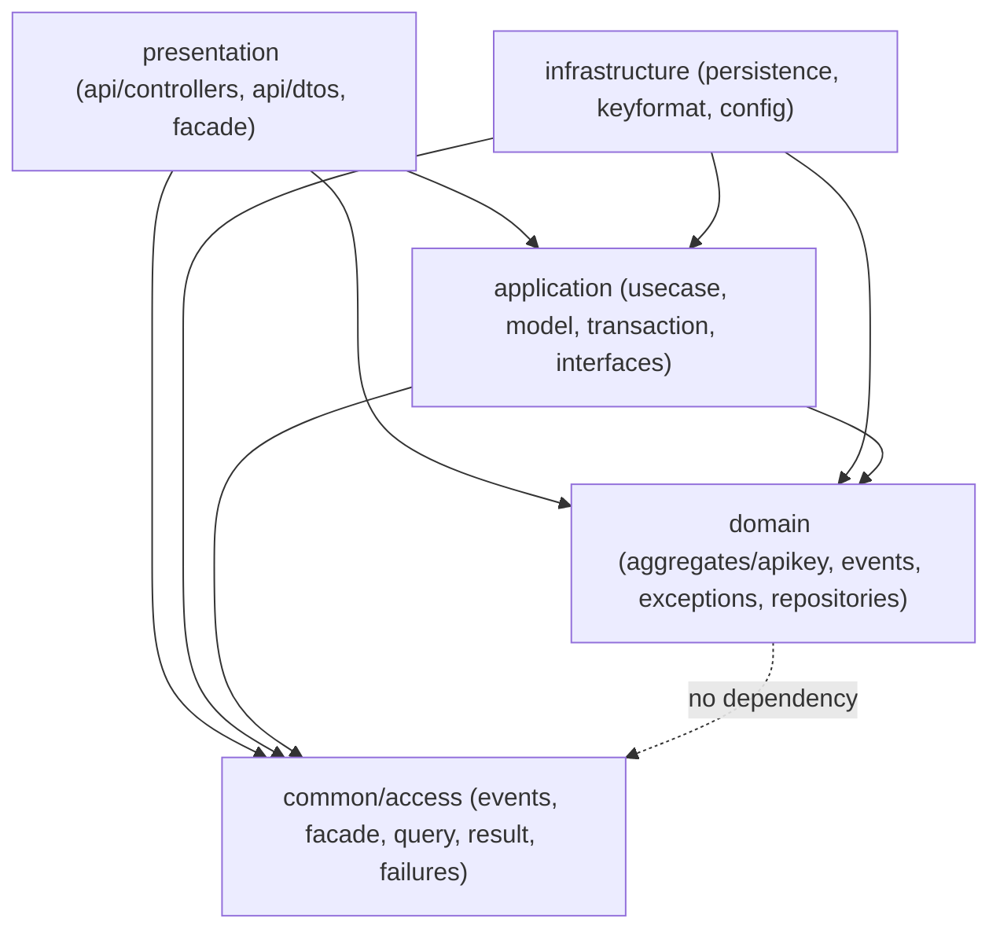

An arrow means "may depend on". `application` never depends on `presentation` or `infrastructure`; those two never
depend on each other. `common` is framework-free and domain-free: it is plain records, enums and one interface. The
domain owns its events and never imports `common`; the application's `ApiKeyProjectionMapper` translates domain events
into the published commands and permission maps. The repository contract (`domain/repositories/ApiKeys`) lives in the
domain, so `application` and `infrastructure` both depend on it and nothing points back at them. `presentation` may
not use the repository contract or `application/interfaces` directly; it talks to the use cases.

### 2. Domain (`access/domain`)

The aggregate and its value types are in `domain/aggregates/apikey`, its events in
`domain/aggregates/apikey/events`, the exceptions in `domain/exceptions`, the repository contract in
`domain/repositories`. `Permissions`, `Scope`, `AccessLevel`, `FailureReason` and `ChangeKind` are domain types too:
`FailureReason` is the aggregate's own reason for a failed change, mapped from the incoming `common`
`ApiKeyChangeFailureReason` by `RejectChangeHandler`. The incoming events themselves are published in
`common/access/events/inbound` (section 3).

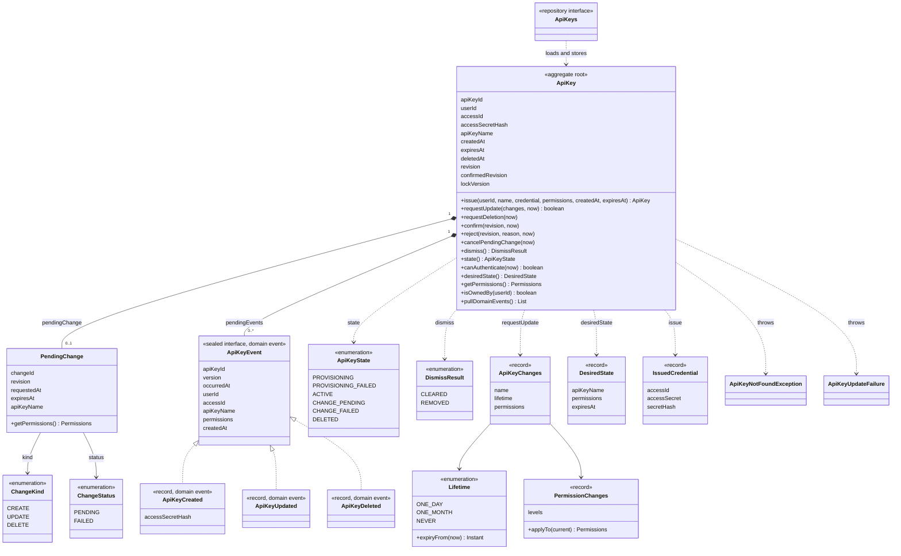

How the pieces fit: `confirmedRevision` and the plain fields (`apiKeyName`, permissions, `expiresAt`) hold the
**confirmed** state. A requested change lives in `PendingChange` until the data plane confirms it. `state()` is
derived from `deletedAt` and the pending change; it is never stored. `revision` is the change counter carried
as `version` in events. `ApiKeyNotFoundException` and `ApiKeyUpdateFailure` are plain runtime exceptions. `PendingChange` points at `ChangeKind` and
`FailureReason` (both domain).

### 3. Published contracts (`common/access`) and the mapper

`common/access` holds plain, domain-free records, a sealed verification result and one interface. Permissions cross
the boundary as a `Map<String, String>` (scope name to level name), so `common` never imports `domain`; the domain
owns its own events and never imports `common`. `ApiKeyProjectionMapper` (in `access/application/events`) is the only
place the domain model and the published contract meet.

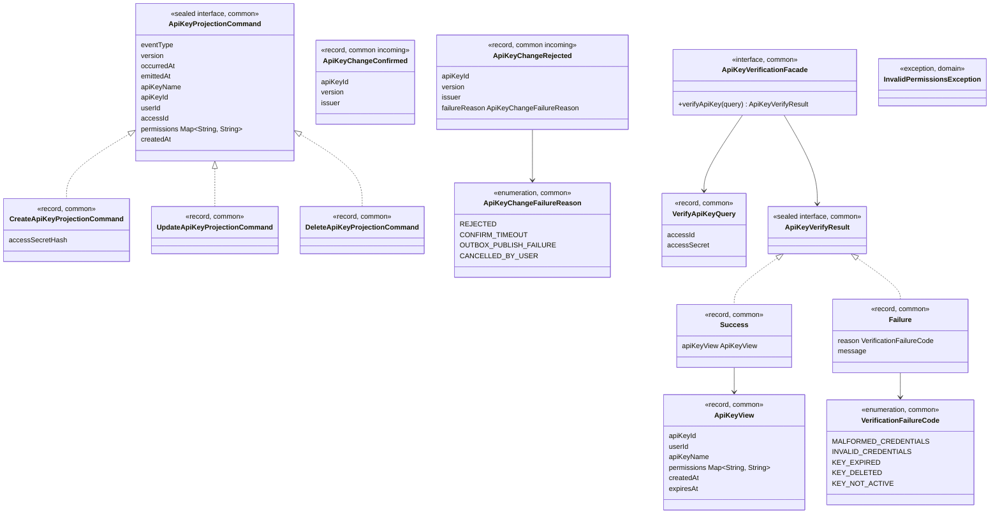

`ApiKeyProjectionCommand` is sealed: only the three records may implement it, and they are the only things Access
writes to the outbox. They carry the key's `createdAt` and `expiresAt`; `occurredAt` is when the change reached the
outbox, `emittedAt` is null until something publishes it. `permissions` is a scope-name to level-name map; the wire
names are `INGESTION`,
`TENANT`, `CHANNEL` and `NONE`, `READ`, `WRITE`, `READ_WRITE`. `ApiKeyChangeConfirmed` and `ApiKeyChangeRejected`
go the other way: they are what the data plane sends back, and they are the inputs of `ConfirmChangeUseCase` and
`RejectChangeUseCase`. A reject carries `common`'s `ApiKeyChangeFailureReason`; the application maps it to the
domain's `FailureReason`.

`ApiKeyProjectionMapper.toProjectionCommand(ApiKeyEvent)` uses an exhaustive `switch` over the sealed domain event
type. `toWirePermissions(Permissions)` copies the domain's scope/level map into an ordered, unmodifiable
`Map<String, String>`. The mapper deliberately leaves `emittedAt` null: only the relay stamps it. The aggregate
registers nothing when a change is confirmed, and only the compensating domain event when one fails.

`ApiKeyVerificationFacade.verifyApiKey(...)` returns `ApiKeyVerifyResult`, and never throws for a rejected credential.
`Success` carries the secret-free `ApiKeyView`; `Failure` carries a machine-readable `VerificationFailureCode` and an
end-user-safe message, so callers branch on the result instead of catching an Access exception. Access internally
reports a rejection by throwing `ApiKeyVerificationFailure` from
`access.application.usecase.service.verify`; `ApiKeyFacadeImpl` catches it and returns `Failure`. The test-only
`VerifyProbeController` translates a `Failure` back into that internal exception so the HTTP 400/401 mapping stays
covered. `InvalidPermissionsException` stays a domain exception.

### 4. Application layer (`access/application`)

Each row of the diagram is one operation: HTTP or facade -> use case -> handler -> the repository (a domain contract) and the credential interfaces.

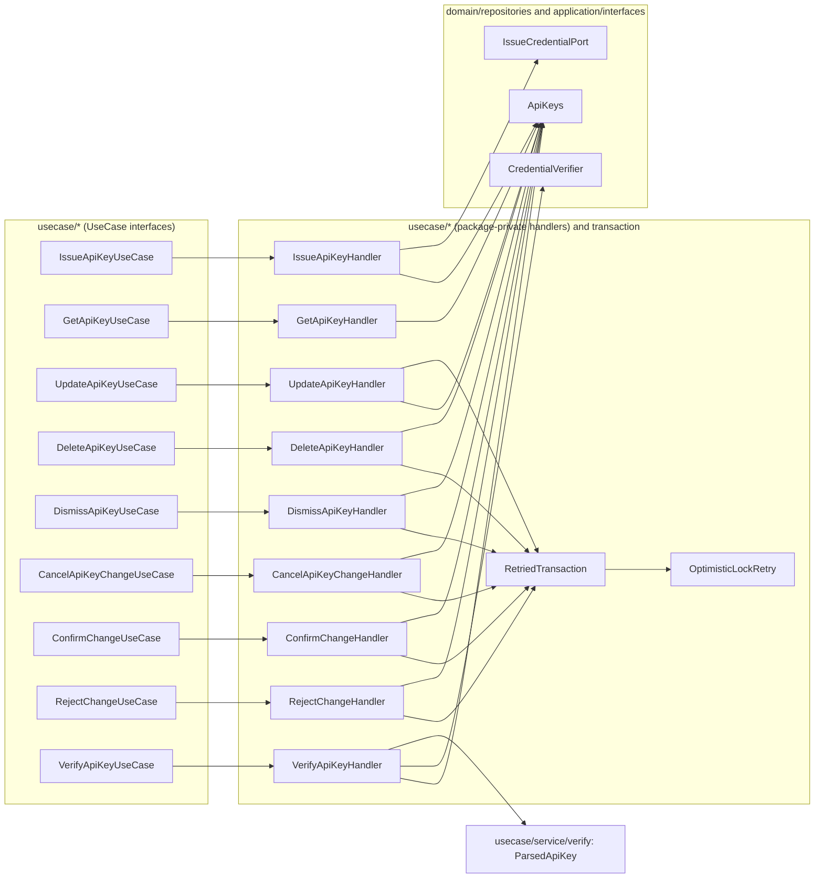

Inputs and outputs of each use case (all records, each in its own `usecase/user/<name>` or `usecase/service/<name>` package except `ApiKeyView` in `application/model` and `VerifyApiKeyQuery` in `common/access`):

| Use case | Takes | Returns |
|---|---|---|
| `IssueApiKeyUseCase` | `IssueApiKeyCommand(userId, name, lifetime, permissions)` | `IssuedApiKeyResult(key, accessSecret)`: the only place the secret appears |
| `GetApiKeyUseCase` | `GetApiKeyQuery(userId, apiKeyId)` | `ApiKeyView` (no secrets, the HTTP layer turns its `state` and `changeKind` into the public `ApiKeyStatus`) |
| `UpdateApiKeyUseCase` | `UpdateApiKeyCommand(userId, apiKeyId, name, lifetime, permissions)` | `ApiKeyView` |
| `DeleteApiKeyUseCase` | `DeleteApiKeyCommand(userId, apiKeyId)` | nothing |
| `DismissApiKeyUseCase` | `DismissApiKeyCommand(userId, apiKeyId)` | nothing |
| `CancelApiKeyChangeUseCase` | `CancelApiKeyChangeCommand(userId, apiKeyId)` | nothing |
| `ConfirmChangeUseCase` | incoming event `ApiKeyChangeConfirmed(apiKeyId, version, issuer)` | nothing |
| `RejectChangeUseCase` | incoming event `ApiKeyChangeRejected(apiKeyId, version, issuer, failureReason)` | nothing |
| `VerifyApiKeyUseCase` | `VerifyApiKeyQuery(accessId, accessSecret)` (in `common/access`) | `VerifiedApiKey` |

Notes: `GetApiKeyHandler` and `VerifyApiKeyHandler` run in read-only transactions and `IssueApiKeyHandler` is
`@Transactional`. Every handler that changes an existing key (Update, Delete, Dismiss, CancelChange, ConfirmChange, RejectChange)
goes through `RetriedTransaction`: a fresh `REQUIRES_NEW` transaction per attempt, retried through
`OptimisticLockRetry` when another writer changed the key first. Each retry re-reads the key, so the domain rules
decide the outcome against its current state. When retries run out the caller gets `ApiKeyUpdateFailure` (409).
`ParsedApiKey` (in `usecase/service/verify`) is an internal record that splits `V1_xxx` into access ID, secret and key format.
`RetriedTransaction` and `OptimisticLockRetry` are public classes in `application/transaction` because handlers in
several packages use them; the handlers themselves stay package-private.

### 5. Presentation and infrastructure (`access/presentation`, `access/infrastructure`)

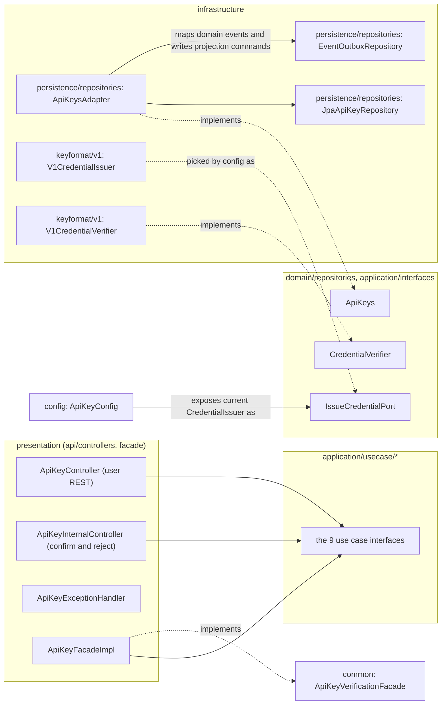

`V1CredentialIssuer` implements `CredentialIssuer` (infrastructure-local interface), not `IssueCredentialPort` directly:
`ApiKeyConfig` picks the issuer whose `keyFormat()` equals `access.key-format.current` (default `V1`) and exposes
it as the single `IssueCredentialPort` bean. `ApiKeyFacadeImpl` implements the `common` `ApiKeyVerificationFacade`
and takes a `VerifyApiKeyQuery`. `ApiKeyExceptionHandler` (in `presentation/api/controllers`) maps exceptions to HTTP: not found 404,
update failure 409, verification failure 401, parsing failure and invalid permissions 400.

### 6. Sequence: update an API key

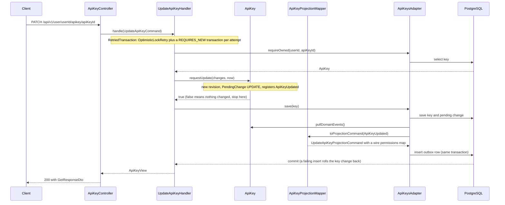

### 7. Sequence: verify an API key

```mermaid
sequenceDiagram
    participant Caller
    participant F as ApiKeyFacadeImpl
    participant H as VerifyApiKeyHandler
    participant V as CredentialVerifier
    participant Ad as ApiKeysAdapter
    participant Key as ApiKey

    Caller->>F: verifyApiKey(VerifyApiKeyQuery)
    F->>H: handle(VerifyApiKeyQuery)
    H->>H: ParsedApiKey.parse (bad format: MALFORMED_CREDENTIALS)
    H->>V: find verifier that supports the key format
    H->>Ad: findByAccessId(accessId)
    Ad-->>H: ApiKey (missing: INVALID_CREDENTIALS)
    H->>V: matches(presentedSecret, storedHash)
    V-->>H: false means INVALID_CREDENTIALS
    H->>Key: canAuthenticate(now)
    Key-->>H: false for provisioning, deleted or expired keys: KEY_NOT_ACTIVE, KEY_DELETED or KEY_EXPIRED
    H-->>F: VerifiedApiKey
    F-->>Caller: Success(new ApiKeyView(...))
    Note over H,F: On a rejection the handler throws ApiKeyVerificationFailure; the facade catches it and returns Failure(code, message)
```

A rejected verification is delivered as `ApiKeyVerifyResult.Failure` with a machine-readable `reason` and a message
written for end users, so a gateway can branch on the code and pass the message on. It is never an exception across the
facade boundary. An unknown access id, a wrong secret and an unsupported key format are one outcome
(`INVALID_CREDENTIALS`), and the secret is checked before the key's state, so `KEY_EXPIRED`, `KEY_DELETED` and
`KEY_NOT_ACTIVE` are only ever revealed to a caller who holds the right secret. Nothing leaks about keys they do not
hold.

| Code | Message | HTTP (if mapped) |
|---|---|---|
| `MALFORMED_CREDENTIALS` | The API key is missing or not in a recognized format. | 400 |
| `INVALID_CREDENTIALS` | The API key or secret is invalid. | 401 |
| `KEY_EXPIRED` | The API key has expired. | 401 |
| `KEY_DELETED` | The API key has been deleted. | 401 |
| `KEY_NOT_ACTIVE` | The API key is not active. | 401 |

### 8. Package tree (every class)

```
me.dhiren9939.backend
├── BackendApplication                      Spring Boot entry point
├── common/access/                         published contracts (domain-free, no framework dependencies)
│   ├── ApiKeyVerificationFacade            in-process "verify this credential" entry point
│   ├── VerifyApiKeyQuery                   access ID plus presented secret (toString masks the secret)
│   ├── ApiKeyVerifyResult                  sealed Success(ApiKeyView) or Failure(VerificationFailureCode, message)
│   ├── ApiKeyView                          secret-free payload carried by Success
│   ├── VerificationFailureCode             MALFORMED_CREDENTIALS, INVALID_CREDENTIALS, KEY_EXPIRED, KEY_DELETED, KEY_NOT_ACTIVE
│   └── events/
│       ├── outbound/                       what Access sends to the data plane (the outbox)
│       │   ├── ApiKeyProjectionCommand         sealed interface of the three projection commands
│       │   ├── CreateApiKeyProjectionCommand   revision requested for a new key (carries the secret hash)
│       │   ├── UpdateApiKeyProjectionCommand   revision requested for a changed key
│       │   └── DeleteApiKeyProjectionCommand   revision requested for a deleted (or failed-creation) key
│       └── inbound/                        what the data plane sends back to Access
│           ├── ApiKeyChangeConfirmed           the data plane applied a revision
│           ├── ApiKeyChangeRejected            a revision failed (with an ApiKeyChangeFailureReason)
│           └── ApiKeyChangeFailureReason       REJECTED, CONFIRM_TIMEOUT, OUTBOX_PUBLISH_FAILURE, CANCELLED_BY_USER
└── access/
    ├── domain/
    │   ├── aggregates/apikey/
    │   │   ├── ApiKey                      the aggregate: all lifecycle rules, JPA entity
    │   │   ├── PendingChange               the one requested change waiting for the data plane
    │   │   ├── ApiKeyState                 derived lifecycle state
    │   │   ├── ChangeKind / ChangeStatus   CREATE, UPDATE, DELETE / PENDING, FAILED
    │   │   ├── DismissResult               CLEARED or REMOVED
    │   │   ├── DesiredState                state the key is heading for (pending, else confirmed)
    │   │   ├── Lifetime                    ONE_DAY, ONE_MONTH, NEVER and expiryFrom(now)
    │   │   ├── ApiKeyChanges               optional name, lifetime, permission changes
    │   │   ├── PermissionChanges           partial scope-to-level update
    │   │   ├── IssuedCredential            access ID, one-time secret, secret hash
    │   │   ├── Permissions                 immutable scope-to-level map; missing scope = NONE
    │   │   ├── Scope                       INGESTION, TENANT, CHANNEL and the levels each accepts
    │   │   ├── AccessLevel                 NONE, READ, WRITE, READ_WRITE
    │   │   ├── FailureReason               REJECTED, CONFIRM_TIMEOUT, OUTBOX_PUBLISH_FAILURE, CANCELLED_BY_USER
    │   │   └── events/                     ApiKeyEvent (sealed), ApiKeyCreated, ApiKeyUpdated, ApiKeyDeleted
    │   ├── exceptions/                     ApiKeyNotFoundException, ApiKeyUpdateFailure, InvalidPermissionsException
    │   └── repositories/ApiKeys            storage contract for the aggregate
    ├── application/
    │   ├── usecase/                        user/ and service/, one package per operation, each with its *UseCase, *Command or *Query
    │   │   │                               and package-private *Handler:
    │   │   ├── issue/                      IssueApiKeyUseCase/Command/Handler, IssuedApiKeyResult
    │   │   ├── get/                        GetApiKeyUseCase/Query/Handler
    │   │   ├── update/                     UpdateApiKeyUseCase/Command/Handler
    │   │   ├── delete/                     DeleteApiKeyUseCase/Command/Handler
    │   │   ├── dismiss/                    DismissApiKeyUseCase/Command/Handler
    │   │   ├── cancel/                     CancelApiKeyChangeUseCase/Command/Handler
    │   │   ├── confirm/                    ConfirmChangeUseCase/Command/Handler
    │   │   ├── reject/                     RejectChangeUseCase/Command/Handler
    │   │   └── verify/                     VerifyApiKeyUseCase/Handler, VerifiedApiKey, ParsedApiKey, ApiKeyVerificationFailure (query comes from common/access)
    │   ├── events/ApiKeyProjectionMapper   domain events and permissions -> the common projection contract
    │   ├── model/                          ApiKeyView (CRUD read model; the verification view is common/access.ApiKeyView)
    │   ├── transaction/                    RetriedTransaction, OptimisticLockRetry
    │   └── interfaces/                     IssueCredentialPort, CredentialVerifier
    ├── presentation/
    │   ├── api/controllers/                ApiKeyController, ApiKeyInternalController, ApiKeyExceptionHandler
    │   ├── api/dtos/                       CreateRequestDto, UpdateRequestDto, RejectRequestDto,
    │   │                                   CreateResponseDto, GetResponseDto, GetPageResponseDto (unused)
    │   └── facade/ApiKeyFacadeImpl         implements ApiKeyVerificationFacade via VerifyApiKeyUseCase
    └── infrastructure/
        ├── persistence/
        │   ├── models/EventOutboxEntity    the outbox row and its mapping from events
        │   └── repositories/               ApiKeysAdapter, JpaApiKeyRepository, EventOutboxRepository
        ├── keyformat/                      CredentialIssuer, Sha256SecretHasher, SortableEncoder,
        │                                   v1/V1CredentialIssuer, v1/V1CredentialVerifier
        └── config/ApiKeyConfig             Clock, SecureRandom, selects the current key format
```

Database objects (schema `access`): `api_keys`, `pending_changes`, `api_key_permissions`,
`pending_change_permissions`, `outbox`. The hand-written reference SQL is
`backend/src/main/resources/db.migration/access/V1__create_access_schema.sql`.

### 9. Where do I change X?

| I want to... | Change |
|---|---|
| Add a permission scope (e.g. `MONITORING`) | One constant in `domain/aggregates/apikey/Scope` with its allowed levels. Permissions, updates, storage, web and event payloads all work from the enum. `ScopeTest` checks the new constant automatically. |
| Add an event type | New record in `domain/aggregates/apikey/events`, add it to `ApiKeyEvent` `permits`, register it in `ApiKey`, add a branch to `ApiKeyProjectionMapper`, then add the matching `common/access/events/outbound` record and `EventOutboxEntity.of(...)` branch (the compiler forces both switches). Update `ApiKeyProjectionMapperTest`, `ApiKeyProjectionCommandContractTest` and the Access section of this document. |
| Add a use case | A new package `application/usecase/user/<name>` (the key owner asks for it) or `application/usecase/service/<name>` (another service asks for it) with the `*UseCase`, the command or query (and result) and a package-private `*Handler` (writing handlers go through `RetriedTransaction`), a method on `ApiKey` if there is a rule, a controller method, and a handler test in the same test package using `InMemoryApiKeys`. |
| Change the key format | Add `v2/V2CredentialIssuer` (implements `CredentialIssuer`) and `v2/V2CredentialVerifier` (implements `CredentialVerifier`), then set `access.key-format.current=V2`. Keep the V1 verifier so old keys still work. |
| Add or change an endpoint | A method in `presentation/api/controllers/ApiKeyController` mapping to a command, DTOs in `presentation/api/dtos`, errors in `ApiKeyExceptionHandler`. Tests: `ApiKeyControllerTest` and `ApiKeyHttpIntegrationTest`. |
| Change the database schema | Edit the JPA mappings (`ApiKey`, `PendingChange`, `EventOutboxEntity` in `infrastructure/persistence/models`) **and** `V1__create_access_schema.sql`. The app itself uses `ddl-auto=update`; `SqlMigrationValidateIntegrationTest` fails if the SQL file and mappings disagree. |
| Change a business rule | `ApiKey` (or `PermissionChanges` / `Permissions`). Handlers should not need to change. |

## Class hierarchy diagrams
### Layers

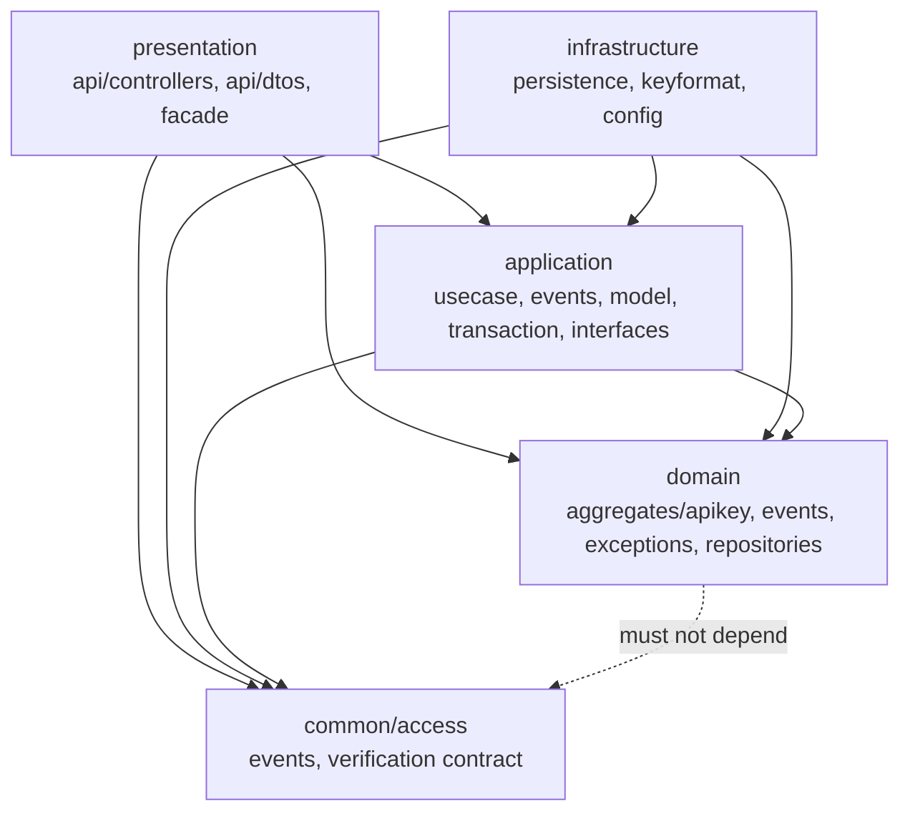

The only bridge between `domain` and `common` is `application.events.ApiKeyProjectionMapper`. `common` imports no
`access` package, so other contexts can publish and consume the contract without seeing the aggregate.

### Domain (`access.domain`)

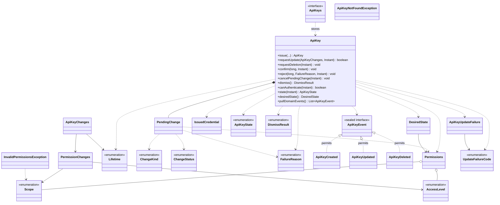

The aggregate is also the JPA entity (`@Entity`, schema `access`). `PendingChange` is a cascade-managed
`@OneToOne`; permissions are `@ElementCollection` rows keyed by `Scope`. `pendingEvents` is `@Transient` and is
drained once by `pullDomainEvents()`.

### Application (`access.application`)

#### Use-case interfaces and handlers

| Operation | Interface | Handler | Input | Output |
|---|---|---|---|---|
| Issue | `IssueApiKeyUseCase` | `IssueApiKeyHandler (package)` | `IssueApiKeyCommand` | `IssuedApiKeyResult` |
| Get | `GetApiKeyUseCase` | `GetApiKeyHandler (package)` | `GetApiKeyQuery` | `ApiKeyView` |
| Update | `UpdateApiKeyUseCase` | `UpdateApiKeyHandler (package)` | `UpdateApiKeyCommand` | `ApiKeyView` |
| Delete | `DeleteApiKeyUseCase` | `DeleteApiKeyHandler (package)` | `DeleteApiKeyCommand` | none |
| Dismiss | `DismissApiKeyUseCase` | `DismissApiKeyHandler (package)` | `DismissApiKeyCommand` | none |
| Cancel | `CancelApiKeyChangeUseCase` | `CancelApiKeyChangeHandler (package)` | `CancelApiKeyChangeCommand` | none |
| Confirm | `ConfirmChangeUseCase` | `ConfirmChangeHandler (package)` | `ApiKeyChangeConfirmed` | none |
| Reject | `RejectChangeUseCase` | `RejectChangeHandler (package)` | `ApiKeyChangeRejected` | none |
| Verify | `VerifyApiKeyUseCase` | `VerifyApiKeyHandler (package)` | `VerifyApiKeyQuery` | `VerifiedApiKey` |

`ConfirmChangeUseCase`, `RejectChangeUseCase` and `VerifyApiKeyUseCase` use the `common` inbound query/event
directly; the user-facing commands and queries are Access application types.

```mermaid
classDiagram
    direction LR

    class IssueApiKeyUseCase { <<interface>> }
    class GetApiKeyUseCase { <<interface>> }
    class UpdateApiKeyUseCase { <<interface>> }
    class DeleteApiKeyUseCase { <<interface>> }
    class DismissApiKeyUseCase { <<interface>> }
    class CancelApiKeyChangeUseCase { <<interface>> }
    class ConfirmChangeUseCase { <<interface>> }
    class RejectChangeUseCase { <<interface>> }
    class VerifyApiKeyUseCase { <<interface>> }

    class IssueApiKeyHandler
    class GetApiKeyHandler
    class UpdateApiKeyHandler
    class DeleteApiKeyHandler
    class DismissApiKeyHandler
    class CancelApiKeyChangeHandler
    class ConfirmChangeHandler
    class RejectChangeHandler
    class VerifyApiKeyHandler

    class IssueApiKeyCommand
    class GetApiKeyQuery
    class UpdateApiKeyCommand
    class DeleteApiKeyCommand
    class DismissApiKeyCommand
    class CancelApiKeyChangeCommand
    class IssuedApiKeyResult
    class ApiKeyView
    class ParsedApiKey
    class VerifiedApiKey

    class ApiKeys { <<interface>> }
    class RetriedTransaction
    class OptimisticLockRetry
    class IssueCredentialPort { <<interface>> }
    class CredentialVerifier { <<interface>> }

    class ApiKeyProjectionMapper {
        +toProjectionCommand(ApiKeyEvent) ApiKeyProjectionCommand
        +toWirePermissions(Permissions) Map~String,String~
    }
    class ApiKeyEvent { <<domain event>> }
    class ApiKeyProjectionCommand { <<common contract>> }

    IssueApiKeyHandler ..|> IssueApiKeyUseCase
    GetApiKeyHandler ..|> GetApiKeyUseCase
    UpdateApiKeyHandler ..|> UpdateApiKeyUseCase
    DeleteApiKeyHandler ..|> DeleteApiKeyUseCase
    DismissApiKeyHandler ..|> DismissApiKeyUseCase
    CancelApiKeyChangeHandler ..|> CancelApiKeyChangeUseCase
    ConfirmChangeHandler ..|> ConfirmChangeUseCase
    RejectChangeHandler ..|> RejectChangeUseCase
    VerifyApiKeyHandler ..|> VerifyApiKeyUseCase

    IssueApiKeyHandler ..> IssueApiKeyCommand
    IssueApiKeyHandler ..> IssuedApiKeyResult
    GetApiKeyHandler ..> GetApiKeyQuery
    GetApiKeyHandler ..> ApiKeyView
    UpdateApiKeyHandler ..> UpdateApiKeyCommand
    DeleteApiKeyHandler ..> DeleteApiKeyCommand
    DismissApiKeyHandler ..> DismissApiKeyCommand
    CancelApiKeyChangeHandler ..> CancelApiKeyChangeCommand
    VerifyApiKeyHandler ..> ParsedApiKey
    VerifyApiKeyHandler ..> VerifiedApiKey

    IssueApiKeyHandler --> ApiKeys
    GetApiKeyHandler --> ApiKeys
    UpdateApiKeyHandler --> ApiKeys
    DeleteApiKeyHandler --> ApiKeys
    DismissApiKeyHandler --> ApiKeys
    CancelApiKeyChangeHandler --> ApiKeys
    ConfirmChangeHandler --> ApiKeys
    RejectChangeHandler --> ApiKeys
    VerifyApiKeyHandler --> ApiKeys

    IssueApiKeyHandler --> IssueCredentialPort
    VerifyApiKeyHandler --> CredentialVerifier
    UpdateApiKeyHandler --> RetriedTransaction
    DeleteApiKeyHandler --> RetriedTransaction
    DismissApiKeyHandler --> RetriedTransaction
    CancelApiKeyChangeHandler --> RetriedTransaction
    ConfirmChangeHandler --> RetriedTransaction
    RejectChangeHandler --> RetriedTransaction
    RetriedTransaction --> OptimisticLockRetry

    ApiKeyProjectionMapper ..> ApiKeyEvent
    ApiKeyProjectionMapper ..> ApiKeyProjectionCommand
```

Every write handler follows the same shape: load through `ApiKeys`, call one aggregate method, save through
`ApiKeys`; `RetriedTransaction` owns the optimistic-lock retry. No handler contains a key rule.

### Presentation (`access.presentation`)

```mermaid
classDiagram
    direction TB

    class ApiKeyController {
        <<package-private>>
    }
    class ApiKeyInternalController {
        <<package-private>>
    }
    class ApiKeyExceptionHandler {
        <<package-private>>
    }
    class ApiKeyFacadeImpl {
        <<package-private>>
    }

    class IssueApiKeyUseCase { <<interface>> }
    class GetApiKeyUseCase { <<interface>> }
    class UpdateApiKeyUseCase { <<interface>> }
    class DeleteApiKeyUseCase { <<interface>> }
    class DismissApiKeyUseCase { <<interface>> }
    class CancelApiKeyChangeUseCase { <<interface>> }
    class ConfirmChangeUseCase { <<interface>> }
    class RejectChangeUseCase { <<interface>> }
    class VerifyApiKeyUseCase { <<interface>> }

    class ApiKeyVerificationFacade { <<interface>> }
    class VerifyApiKeyQuery
    class ApiKeyVerifyResult
    class ApiKeyView

    ApiKeyController --> IssueApiKeyUseCase
    ApiKeyController --> GetApiKeyUseCase
    ApiKeyController --> UpdateApiKeyUseCase
    ApiKeyController --> DeleteApiKeyUseCase
    ApiKeyController --> DismissApiKeyUseCase
    ApiKeyController --> CancelApiKeyChangeUseCase

    ApiKeyInternalController --> ConfirmChangeUseCase
    ApiKeyInternalController --> RejectChangeUseCase

    ApiKeyFacadeImpl ..|> ApiKeyVerificationFacade
    ApiKeyFacadeImpl --> VerifyApiKeyUseCase
    ApiKeyFacadeImpl ..> VerifyApiKeyQuery
    ApiKeyFacadeImpl ..> ApiKeyVerifyResult
    ApiKeyFacadeImpl ..> ApiKeyView
```

DTOs in `presentation/api/dtos`:

| Kind | Classes |
|---|---|
| Requests | `CreateRequestDto`, `UpdateRequestDto`, `ConfirmRequestDto`, `RejectRequestDto` |
| Responses | `CreateResponseDto`, `GetResponseDto`, `GetPageResponseDto`, `ApiKeyStatus` |
| Shared | `RequestPatterns (package)` |

`ApiKeyExceptionHandler` maps `ApiKeyNotFoundException`, `ApiKeyUpdateFailure`, `InvalidPermissionsException` and
Access's internal `ApiKeyVerificationFailure` to HTTP responses (the last one is exercised through the test-only
probe). `ApiKeyFacadeImpl` catches that exception and returns `ApiKeyVerifyResult.Failure`. `ApiKeyController` talks
only to user use cases; `ApiKeyInternalController` and `ApiKeyFacadeImpl` talk only to service use cases.

### Infrastructure (`access.infrastructure`)

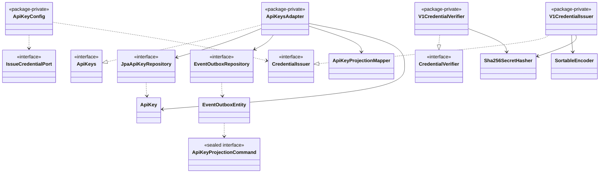

`ApiKeysAdapter` is the only production writer of the outbox. It maps the aggregate's drained domain events with
`ApiKeyProjectionMapper`, converts each command to an `EventOutboxEntity`, and saves it in the caller's transaction.
There is no outbox listener in this context.

### Published contract (`common.access`)

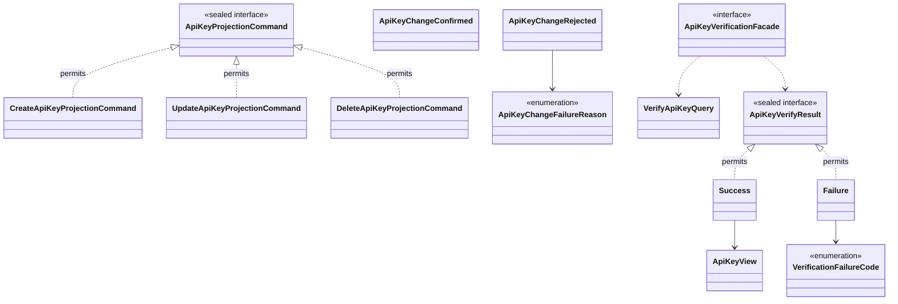

The outbound commands carry permissions as a `Map<String, String>` of scope name to level name, never a domain
type. The inbound events are records the data plane sends; `ApiKeyChangeFailureReason` is the wire vocabulary.
`ApiKeyVerificationFacade` is implemented in `presentation.facade`; other contexts depend on the interface only. The
facade returns `Success(ApiKeyView)` or `Failure(VerificationFailureCode, message)` and never throws for a rejected
credential; the internal `ApiKeyVerificationFailure` lives under `access.application.usecase.service.verify`.

### Runtime path

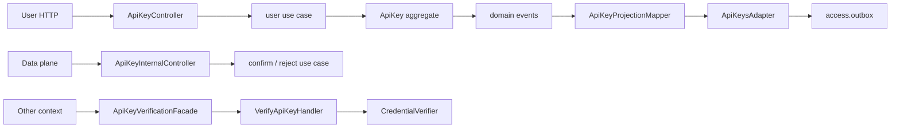

The outbox row and the key change commit in one transaction. Verification is in-process; Access exposes no HTTP
verify endpoint.

## Tests
### Running them

Run from `backend/`. Numbers below were measured on this repo (Windows, Docker Desktop running).

| What | Command | Tests | Time |
|---|---|---|---|
| Unit tests only | `./mvnw test -Dgroups='!integration'` | 245 | about 30 s of Maven time |
| Integration tests only | `./mvnw test -Dgroups=integration` | 42 | about a minute (container start included; varies by machine) |
| Everything | `./mvnw test` | 287 | about 1.5 min |

- **Docker must be running for the integration tests.** They start a throwaway `postgres:17` container with
  Testcontainers (one container per test JVM, shared by all integration classes). They **never** use the
  `maindb` dev database from `docker-compose.yml`; a dev database on `localhost:5432` is not needed or touched.
- "Integration" means a class tagged `@Tag("integration")`. The tag sits on `PostgresIntegrationTest`
  (inherited by every subclass, including `BackendApplicationTests`) and on `SqlMigrationValidateIntegrationTest`.
  There is no special Maven profile; `-Dgroups` is the standard Surefire switch.
- Unit tests need no database, no Docker and no Spring application context. `ApiKeyConfigTest` builds
  `ApiKeyConfig` by hand, and `ApiKeyControllerTest` uses a standalone MockMvc setup.

### Where each kind of test lives

```
src/test/java/me/dhiren9939/backend
├── ArchitectureTest                                 layering rules (ArchUnit)
├── BackendApplicationTests                          Spring context loads on a real Postgres
├── common/access/                                   Permissions and Scope tests (the value types live in domain); events/outbound: outgoing command contract; events/inbound: reject reason contract
├── access/domain/aggregates/apikey/                 ApiKey aggregate, domain events, PermissionChanges
├── access/application/events/                       ApiKeyProjectionMapper (domain events -> published commands)
├── access/application/usecase/{user,service}/<name>/   one test class per handler, in the handler's own package
├── access/application/usecase/                      test-only helpers: Fixtures, InMemoryApiKeys (a fake ApiKeys)
├── access/presentation/api/controllers/             REST controller and error handling (MockMvc, no database): ApiKeyControllerTest, ApiErrorHandlingTest; test-only VerifyProbeController
├── access/presentation/facade/                      ApiKeyFacadeImpl returns Success/Failure and never throws
├── access/infrastructure/persistence/               JPA mapping check (no database)
├── access/infrastructure/persistence/models/        outbox row mapping
├── access/infrastructure/persistence/repositories/  ApiKeysAdapter writes events to the outbox
├── access/infrastructure/keyformat/v1/              V1 credential issuer and verifier
├── access/infrastructure/config/                    key-format selection
└── integration/                                     real Postgres through the real application
```

### Unit tests (245)

#### Domain and common contracts

| Class (tests) | How | What it checks |
|---|---|---|
| `ApiKeyTest` (76) | Pure Java, no Spring, no mocks. Plain `ApiKey` objects and a fixed clock. | The aggregate's rules, grouped by method: **issue** (provisioning key at revision 1, readable by its owner but not yet authenticating); **canAuthenticate** (a key with a pending update still works with its old attributes; expired, provisioning and deleted keys do not); **requestUpdate** (each field alone, all at once, setting a scope to `NONE` revokes it, and every no-op case: same name, same level, same expiry, empty changes); **refusals** (update or delete refused while creating, pending, failed or deleted); **confirm** (creation activates, update applies, delete leaves a `DELETED` tombstone, a stale revision is refused); **reject** (records the reason, then registers the compensating domain event at the next revision: delete for a failed creation, update of the confirmed state for a failed update, create for a failed delete; cancelling a pending change does the same with `CANCELLED_BY_USER`); **dismiss** (a failed update or delete clears, a failed creation or a tombstone is removed; none of them registers anything); **domain events** (right `ApiKeyCreated`/`ApiKeyUpdated`/`ApiKeyDeleted` type, revision, `occurredAt = now`, secret hash only on creation, nothing registered for no-ops or refused changes, events handed over once); **desiredState** and **state()**. |
| `PermissionChangesTest` (6) | Pure Java | Only the listed scopes change, `NONE` revokes, empty changes change nothing, `null` levels are dropped, an invalid level for a scope is rejected when the changes are built, the input map is copied. |
| `PermissionsTest` (10) | Pure Java | A never-granted scope is `NONE`, `with(...)` returns a copy, explicit `NONE` equals missing, `INGESTION` accepts only `WRITE` while `TENANT`/`CHANNEL` accept every level, `asMap()` is unmodifiable, the input map is copied. |
| `ScopeTest` (6) | Loops over `Scope.values()` | Every scope allows `NONE` and at least one real level, and every allowed level round-trips through `Permissions`. A new scope is covered automatically and fails here if it is declared inconsistently. |
| `ApiKeyProjectionMapperTest` (6) | Plain object test | Each domain event maps to the matching command (`ApiKeyCreated` -> create, `ApiKeyUpdated` -> update, `ApiKeyDeleted` -> delete) with the same fields, `emittedAt` left null, permissions as a scope-name to level-name map in scope-declaration order, no `NONE` entries, an unmodifiable map, and the wire names pinned. |
| `ApiKeyProjectionCommandContractTest` (7) | Reflection over the event records | The published event shape: exact field names and order for created, updated and deleted payloads, event-type strings (`apiKey.projection.create`, `apiKey.projection.update`, `apiKey.projection.delete`), the `expiresAt` field alongside both `occurredAt` and `emittedAt` and `createdAt`, `permissions` is a `Map<String, String>`, and `ApiKeyProjectionCommand` is sealed and permits exactly those three records. Changing a field fails this test on purpose: it is a contract change. |
| `ApiKeyChangeFailureReasonContractTest` (2) | Pure Java | The common reject-reason names are exactly `REJECTED`, `CONFIRM_TIMEOUT`, `OUTBOX_PUBLISH_FAILURE`, `CANCELLED_BY_USER`, and `ApiKeyChangeRejected` carries one. |
| `ApiKeyFacadeImplTest` (3) | Plain object test with a mocked `VerifyApiKeyUseCase` | A `VerifiedApiKey` becomes `Success` with an `ApiKeyView` carrying the same identity and timestamps; domain `Permissions` become a string map (`{}` when empty); the handler's internal `ApiKeyVerificationFailure` becomes `Failure` with the same reason and message, and the facade does not throw. |

#### Use-case handlers (`access/application/usecase/{user,service}/<name>`)

Each handler test sits in its handler's package, because the handlers are package-private. They use `InMemoryApiKeys`
(a hand-written fake of the `ApiKeys` repository, not Mockito) and `Fixtures` (fixed clock, test user IDs, key
factories such as `provisioning()` and `active()`, a no-op `RetriedTransaction`), both public in
`access/application/usecase`. The fake behaves like the real
adapter in one important way: whenever a key is saved or deleted it collects the key's domain events, maps them through the real `ApiKeyProjectionMapper`, and appends the resulting commands to `publishedEvents`, so tests can assert exactly what would reach the outbox.

| Class (tests) | Main scenarios |
|---|---|
| `IssueApiKeyHandlerTest` (5) | Stores a provisioning key and returns the secret once; registers exactly one `CreateApiKeyProjectionCommand` at revision 1 carrying the hash; `NEVER` means no expiry, `ONE_DAY` expires tomorrow; the result's `toString` hides the secret. |
| `GetApiKeyHandlerTest` (7) | Owner sees an active key, a provisioning key, failed states and a `DELETED` tombstone; an unknown key and another user's key look identical (not found). |
| `UpdateApiKeyHandlerTest` (11) | A name change creates a pending update and one event; a permission patch touches only the given scopes; a lifetime change restarts expiry; **noopSameValue** and other no-ops save nothing and emit nothing; provisioning, pending, failed and deleted keys cannot be updated; exhausted optimistic-lock retries become `ApiKeyUpdateFailure`. |
| `DeleteApiKeyHandlerTest` (5) | Requests deletion and registers one `DeleteApiKeyProjectionCommand`; refused for provisioning, pending, failed and deleted keys; unknown or foreign key is not found. |
| `DismissApiKeyHandlerTest` (6) | Failed change: cleared, key stays, no event. Failed creation: key removed, no event (the delete went out when it was rejected). Tombstone: removed, no event. A healthy key has nothing to dismiss (refused). |
| `CancelApiKeyChangeHandlerTest` (6) | Cancelling a pending update or creation fails it as `CANCELLED_BY_USER` and emits the compensating command; nothing pending or already failed is refused; only the owner can cancel; exhausted retries become a conflict. |
| `ConfirmChangeHandlerTest` (6) | Confirming a creation activates the key and emits no projection command; confirming a delete leaves a visible tombstone; a stale revision, nothing pending, or an unknown key is refused; exhausted retries become a conflict. |
| `RejectChangeHandlerTest` (6) | Rejecting a creation fails provisioning and emits the compensating delete at revision 2; every common `ApiKeyChangeFailureReason` is mapped to the domain reason and recorded; a stale revision, an unknown key or a missing reason is refused; exhausted retries become a conflict. |
| `VerifyApiKeyHandlerTest` (10) | An active key with the right secret authenticates; a pending update still authenticates with confirmed permissions; a pending delete still authenticates; unknown, provisioning, failed, deleted, expired and wrong-secret cases all fail with the **same** message; a malformed access ID is a parsing failure; secrets never appear in `toString`. |

#### Adapters and config

| Class (tests) | How | What it checks |
|---|---|---|
| `ApiKeyControllerTest` (15) | Standalone MockMvc; the use case interfaces are small hand-written lambdas that record the commands they receive. No Spring context, no database. | Routing and JSON shapes: responses list every scope (`NONE` where never granted); a level a scope does not accept is 400 on create and patch; unknown scope or level names are 400; PATCH sends only the listed scopes and leaves omitted fields null in the command; GET never exposes a secret; cancel returns 204 and sends its command; the internal confirm/reject endpoints carry the revision and reject defaults to `REJECTED`. |
| `ApiErrorHandlingTest` (14) | Standalone MockMvc with the real exception handlers and the test-only `VerifyProbeController`. | RFC 9457 bodies and status mapping: validation field errors, malformed or wrong-type bodies, unknown routes and methods, unsupported media types, domain conflicts, and verification/parsing failures becoming 401 and 400 instead of 500. |
| `EventOutboxEntityTest` (4) | Plain object test | Each projection command (create, update, delete) maps to the right outbox row; the secret hash is only on created; permissions are stored as a JSON object keyed by scope. |
| `ApiKeysAdapterTest` (4) | Plain object test with mocked repositories | Saving or deleting a key writes its events to the outbox and drains them; no events writes nothing; a failing outbox write surfaces so the transaction rolls back. |
| `JpaMappingTest` (5) | Builds Hibernate metadata offline (no database) | Permissions are scope-to-level rows in the `access` schema for both the key and the pending change; no per-scope columns are left; the outbox keeps permissions as one text column and carries `expires_at`; every entity table is in schema `access`. This checks the annotations only, not behaviour. |
| `V1CredentialTest` (5) | Pure Java | Issued credentials carry the `V1_` prefix and a hash of the secret; every credential is different; the verifier accepts the right secret and rejects others; a malformed stored hash never matches (returns false instead of throwing). |
| `ApiKeyConfigTest` (3) | Pure Java | New credentials use the configured key format; matching is case-insensitive; a format nobody can issue fails fast at startup. |
| `ApiKeyStatusTest` (3) | Pure Java | The response status derives from the aggregate state and pending kind: creating/creation-failed, active, expired, deleted, updating/deleting and update-failed/delete-failed; a pending change does not change an already settled state. |

#### `ArchitectureTest` (14)

ArchUnit reads the compiled production classes and fails the build if a layer imports something it should not.
The rules enforced:

1. `domain` (including `domain.repositories`) depends only on itself, `java.*`, `jakarta.persistence`, Lombok, the UUID generator and JSpecify.
2. `domain` has no Spring dependency.
3. `common` never depends on the `access` domain, application, presentation or infrastructure layers; it may use `java.*`, Lombok, JSON and the Jakarta validation API.
4. `application` never depends on `presentation` or `infrastructure`.
5. The four layers only point inwards (ArchUnit layered architecture): `presentation` and `infrastructure` are used by no layer, `application` only by those two, `domain` only by `application`, `presentation` and `infrastructure`.
6. Use case interfaces (in `application.usecase..`) are implemented only inside `application.usecase..`.
7. `presentation` does not depend on `infrastructure`, `domain.repositories` or `application.interfaces`.
8. `infrastructure` does not depend on `presentation` or `application.usecase..` (the handlers).
9. `domain` never depends on `common`.
10. No field injection (`@Autowired`, `@Inject`).
11. `*Handler` classes in `application.usecase..` are not public.
12. No package cycles among the four layers inside `access`.
13. User use cases (`usecase.user..`) and service use cases (`usecase.service..`) never depend on each other.
14. The user API controller (`ApiKeyController`) only calls user use cases; the internal controller and the facade only call service use cases.

### Integration tests (42)

All of these run the real application against a throwaway Postgres 17. Each test starts with empty Access tables
(`TRUNCATE`) and a clock that can be pinned.

#### Helpers (not tests themselves)

| Class | Role |
|---|---|
| `PostgresIntegrationTest` | Base class: `@SpringBootTest`, tagged `integration`, starts the `postgres:17` Testcontainers container once per JVM and points the datasource at it. Pins the JVM time zone to `Asia/Kolkata` (same as `BackendApplication.main`) because the JDBC driver and Postgres disagree about the alias `Asia/Calcutta`. |
| `AccessIntegrationTest` | Base for the Access tests: wires every use case, a `JdbcTemplate`, MockMvc and the test clock; helpers `issue`, `issueActive`, `view`, `count` and `outbox()` (reads the rows of the outbox table). |
| `TestClockConfig` + `MutableClock` | Replace the application `Clock` with one tests can pin to a moment or move forward, so expiry can be tested without waiting. |
| `access/presentation/api/controllers/VerifyProbeController` | Test-only endpoint `GET /test-probe/verify`. Nothing in the app exposes verification over HTTP, so this lets tests prove that verification and parsing failures become 401 and 400 instead of 500. It lives in the test sources only. |

#### Test classes

| Class (tests) | What it proves |
|---|---|
| `BackendApplicationTests` (1) | The whole Spring context starts against the container: bean wiring, entity mappings, the schema. |
| `AccessSchemaIntegrationTest` (4) | With the app's normal `ddl-auto=update` config: schema `access` exists and nothing was created in `public`; every table has exactly the expected columns (the outbox carries a nullable `expires_at`); per-scope permission columns and version-tracking columns are gone; unique and foreign-key constraints exist. |
| `ApiKeyLifecycleIntegrationTest` (17) | The whole key lifecycle through the use case interfaces with a real database: issue (provisioning key, one `apiKey.projection.create` row, secret never stored), confirm (active, permissions stored, pending rows gone), verify (success, and unknown/provisioning/wrong-secret/expired all fail identically), update (pending update, `apiKey.projection.update` at revision 2, confirmed state unchanged until confirm, then applied), no-op update (no event, no revision), refused changes (pending, stale revision, provisioning), reject then dismiss (the compensating update goes out at reject; dismiss emits nothing and leaves no rows), cancel (`CANCELLED_BY_USER`, compensating update at revision 3, dismiss emits nothing), delete then confirm (`DELETED` tombstone, dismiss removes everything with no new event), rejected delete (a restoring `apiKey.projection.create` at revision 3), rejected creation (`apiKey.projection.delete` at revision 2 at once, dismiss removes the key and emits nothing), dismissing a healthy key is refused, ownership. |
| `ApiKeyAtomicityIntegrationTest` (4) | A database trigger refuses outbox rows for a key named `boom`, so the outbox write really fails. Then: a failed issue leaves no key, pending change or permission rows; a failed update leaves the key at its old revision; a failed delete leaves it active; a failing outbox write while rejecting a creation keeps the change pending. This is the "key change and outbox row commit together or not at all" guarantee. |
| `ApiKeyConcurrencyIntegrationTest` (5, one test repeated 5 times) | 8 threads update the same key at once. Exactly one succeeds; the other 7 get `ApiKeyUpdateFailure` (HTTP 409); the key ends at revision 2 with one pending change and one `apiKey.projection.update` outbox row whose content matches the winning change. |
| `ApiKeyHttpIntegrationTest` (7) | Full stack over MockMvc: create, read, confirm, patch, conflict, reject, dismiss, delete, tombstone; 404 for unknown and foreign keys and on the internal endpoints; 409 for changing a key whose creation is pending; 400 for a level a scope does not accept, unknown scope, unknown level and malformed body; 400 for a create without name or expiry (not a 500); 401 and 400 from verification failures through the test probe. |
| `SqlMigrationValidateIntegrationTest` (4) | Applies only the hand-written `V1__create_access_schema.sql` to a fresh database, then boots with `ddl-auto=validate` so Hibernate refuses to start on any mismatch. Also checks every time column is `timestamp with time zone`, that an `Instant` round-trips unchanged under a different session time zone, and that a full key lifecycle runs on the hand-written tables. |

### What the tests do NOT prove

- **The app has never been started with `BackendApplication.main` against the dev database.** The tests start the
  Spring context through `@SpringBootTest` on a container, which is close but not the same entry point.
- **`emitted_at` is only ever null.** No relay reads the outbox and publishes rows, so nothing fills it in. Tests
  check that it stays null, not that publishing works.
- **The concurrency test does not say why a loser lost.** It accepts any `ApiKeyUpdateFailure`, which can come from
  the optimistic-lock retry running out or from the state check ("pending changes") on a retried attempt. Either
  way the outcome (one winner, no corruption) is what is asserted.
- **Verification over real HTTP is only proven through a test-only probe.** The production app has no HTTP verify
  endpoint; `ApiKeyVerificationFacade` is in-process. The 401/400 mapping is tested via `VerifyProbeController`.
- **Key expiry is propagated but never enforced by the data plane.** Projection commands carry `expiresAt` and the
  outbox stores it, but there is no expiry event and no expiry scheduler; whether a projection refuses expired keys
  is the data plane's choice. Tests cover enforcement inside Access only (`canAuthenticate`).
- **Access to the internal confirm/reject endpoints is not secured or tested.** They are meant to sit behind the
  network or gateway; no authentication exists yet (the owner `userId` comes from the URL path).
- **`JpaMappingTest` is offline.** It validates annotations; the integration tests are what exercise the database.
- **No performance or load testing** beyond the 8-thread update race.

### Reading a failing test

| Symptom | Look at |
|---|---|
| `ApiKeyTest` or a handler test fails | The rule in `access/domain/aggregates/apikey/ApiKey.java`. Handlers only load, call and save. |
| `ApiKeyProjectionCommandContractTest` or `ApiKeyProjectionMapperTest` fails | Someone changed an event or command field, name, order or type string. That is a public contract change: confirm it is intended, then update the test, `ApiKeyProjectionMapper` and the Access section of this document. |
| `ApiKeyChangeFailureReasonContractTest` fails | The common reject-reason vocabulary changed. Update `ApiKeyChangeFailureReason`, its mapping in `RejectChangeHandler`, the wire docs and every producer. |
| `ArchitectureTest` names a class | A wrong import crossed a layer. Move the dependency behind an abstraction in `application` instead of loosening the rule. |
| `ScopeTest` or `PermissionsTest` fails after adding a scope | The new constant in `Scope` allows no valid level or omits `NONE`. |
| `ApiKeyControllerTest` fails | Routing, JSON shape or exception-to-status mapping in `presentation/api/controllers`. |
| `JpaMappingTest` fails | An entity annotation or table/column name changed. Also update the SQL file. |
| `SqlMigrationValidateIntegrationTest` fails | The mappings and `V1__create_access_schema.sql` disagree. Fix whichever side is wrong. |
| `AccessSchemaIntegrationTest` fails | What `ddl-auto=update` generates differs from the expected tables and columns. |
| `ApiKeyAtomicityIntegrationTest` fails | The outbox write is no longer part of the key's transaction (`ApiKeysAdapter` no longer writes the outbox row in the caller's transaction). |
| An integration test fails to start | Is Docker running? The error will mention Testcontainers or the container image. They never need `localhost:5432`. |
| Time-dependent failures | The test clock (`MutableClock`) is pinned or not reset; `AccessIntegrationTest` resets it before each test. |
