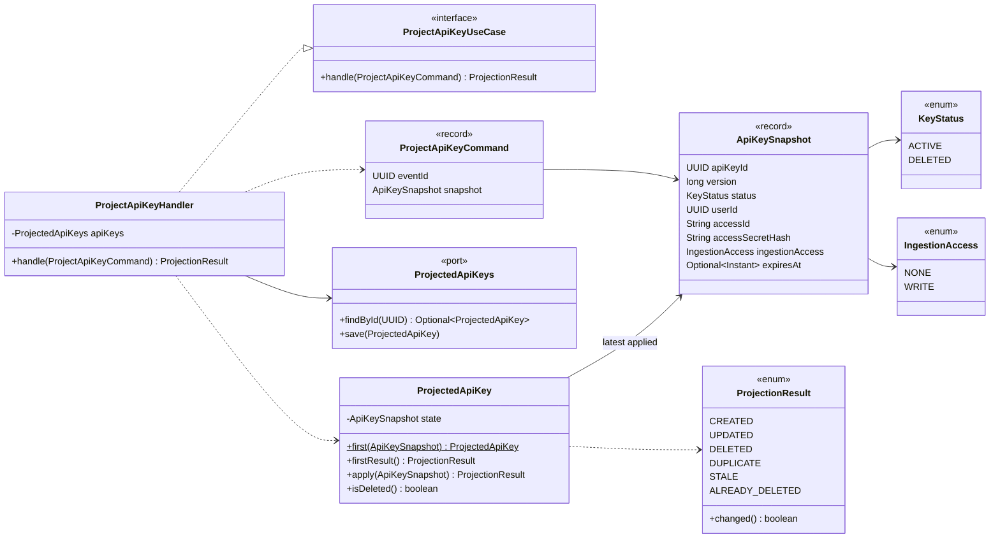

# Ingestion: class diagram

Ingestion authenticates callers from its **own projection** of Access's API keys and never calls Access. Access
publishes every change of a key as a full snapshot with the key's `version` (`apiKey.projection.create`, `.update`
and `.delete` on the super stream `apikey.projections`, see [context-map.md](context-map.md)). This document covers
the projection. Update it with every Ingestion code change.

Built so far: the **core** (domain and application). Not built yet: the stream consumer that drives it, the persistence
adapter, and the authentication use case.

## 1. Packages

| Package | Classes |
|---|---|
| `ingestion.domain.projection` | `ProjectedApiKey`, `ApiKeySnapshot`, `KeyStatus`, `IngestionAccess`, `ProjectionResult` |
| `ingestion.domain.repositories` | `ProjectedApiKeys` (port) |
| `ingestion.application.usecase.projection` | `ProjectApiKeyUseCase`, `ProjectApiKeyCommand`, `ProjectApiKeyHandler` |

The core speaks Ingestion's language only. It depends on neither `common` nor `access` (enforced by
`IngestionArchitectureTest` and `ArchitectureTest`). Translating an Access event into an `ApiKeySnapshot` is the
stream adapter's job.

## 2. Classes



| Class | Responsibility |
|---|---|
| `ApiKeySnapshot` | One version of a key, keeping only what authentication needs. Ingestion's own rules: nothing null, `accessId` and `accessSecretHash` non-blank and at most 256 characters, `version` at least 1. An empty `expiresAt` means the key never expires. Throws `IllegalArgumentException` naming the field. |
| `ProjectedApiKey` | Ingestion's copy of one key; its state is the latest snapshot applied. `first` creates it, `apply` moves it forward by the rules below. Refuses a snapshot of another key. |
| `ProjectionResult` | What one snapshot did; `changed()` says whether the key must be saved. |
| `ProjectedApiKeys` | Output port: find a key (tombstones included) and save it. |
| `ProjectApiKeyHandler` | One snapshot in one transaction: find the key, then create it or apply the snapshot, then save only if it changed. Logs changes at INFO and ignored snapshots at DEBUG. Not a Spring bean until the persistence adapter exists. |

## 3. Applying a snapshot

The relay delivers at least once and a replay can arrive late, so a key only ever moves forward. Whatever order the
snapshots arrive in, the key ends in the same state.

```
first(s)    -> CREATED, or DELETED when the key is first seen as a delete (a tombstone)

apply(s):
  s.version == version -> DUPLICATE        nothing changes
  s.version <  version -> STALE            nothing changes
  key is deleted       -> ALREADY_DELETED  nothing changes: a deleted key never comes back
  otherwise            -> take s whole; DELETED if s is a delete, else UPDATED
```

- **Highest version wins.** Every snapshot is the key's full state, so the newest one alone is enough. A missed event
  needs no resync.
- **Deletes are tombstones.** The key stays, marked deleted, with the version of its delete. Removing it would lose
  that version: a replayed `create v1` after `delete v2` would then bring the key back.
- **A deleted key stays deleted.** Access never revives a deleted key, so a newer non-delete snapshot is a bug or a
  spoof, and Ingestion fails closed.

## 4. Not built yet

- **Translating Access's events.** A tolerant reader ignores unknown JSON keys and unknown scopes. A missing or
  unknown INGESTION level means `NONE`. Create and update map to `ACTIVE`, delete to `DELETED`.
- **Persistence.**
  - The `ingestion.api_keys` table and its migration, which drops the leftover dev tables.
  - The JPA adapter for `ProjectedApiKeys`, with a save that is conditional on version.
- **Stream consumer.** A super-stream single active consumer on `apikey.projections`. The broker tracks offsets,
  stored after the database commit. A new consumer starts from the first message.
- **Failure handling and health.**
- **The authentication use case** on top of the projection.
